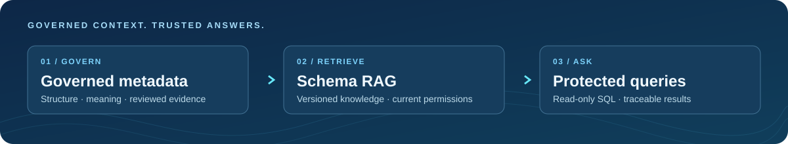
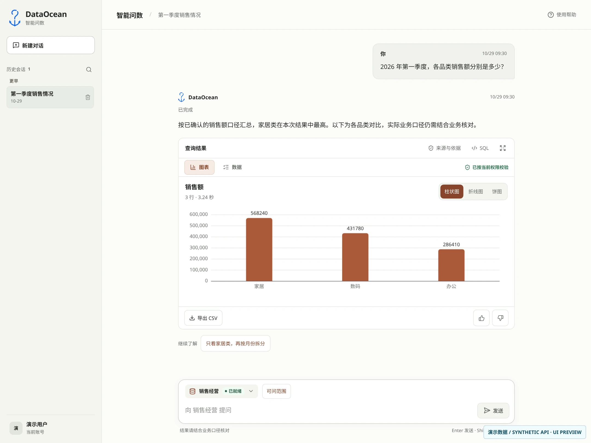
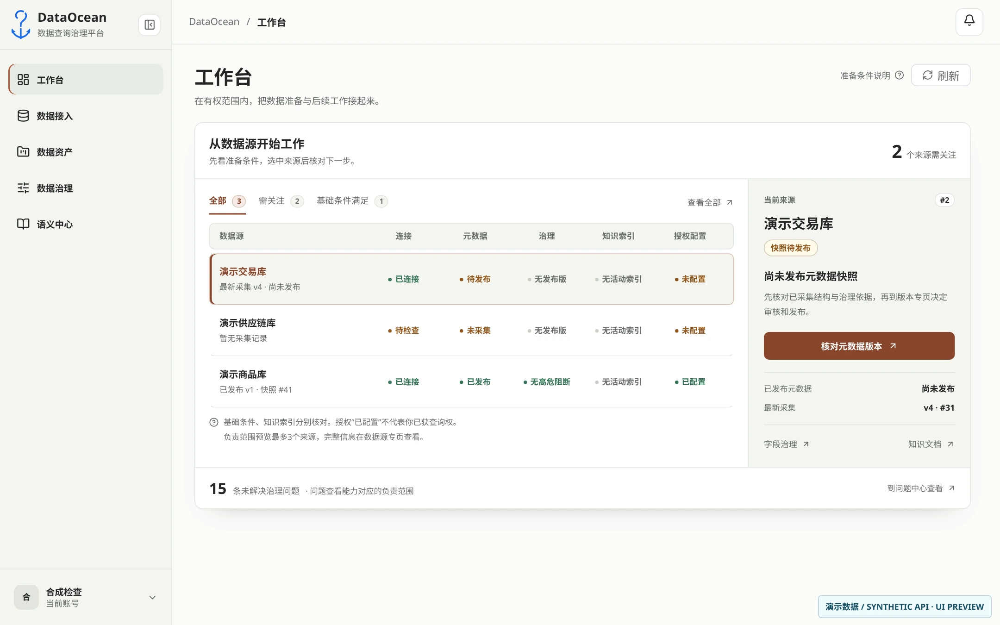
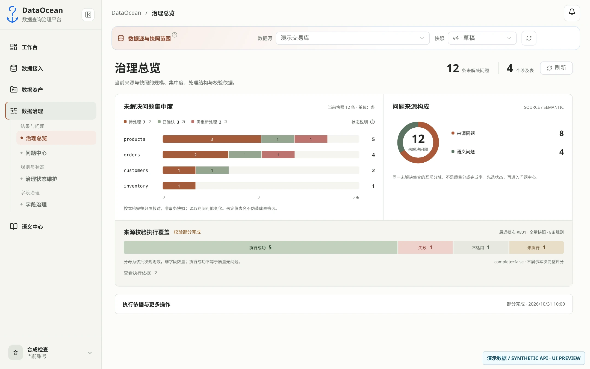
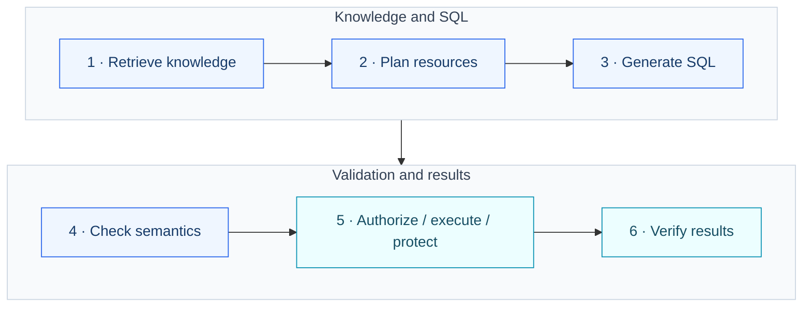
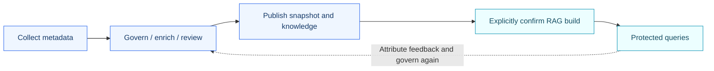
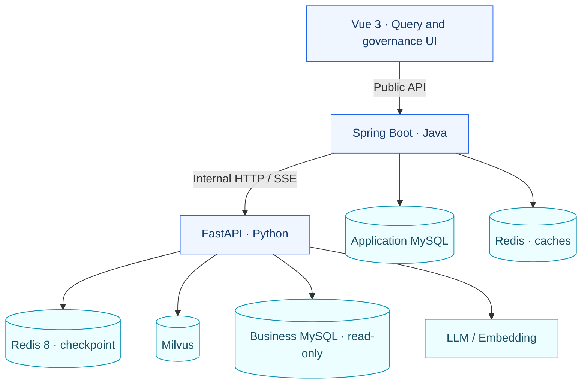

<p align="center">
  
</p>

<h1 align="center">DataOcean</h1>

<p align="center"><strong>Understand your data. Then ask it with confidence.</strong></p>
<p align="center">Natural-language analytics and data governance for enterprise data scenarios</p>

<p align="center"><a href="README.md">简体中文</a> · <strong>English</strong></p>

<p align="center">
  <a href="#features">Features</a> ·
  <a href="#product">Product preview</a> ·
  <a href="#workflow">Query workflow</a> ·
  <a href="#quickstart">Getting started</a> ·
  <a href="#docs">Documentation</a>
</p>

<p align="center">
  
</p>

DataOcean connects natural-language querying (NL2SQL) with metadata governance. Business users select one MySQL datasource and ask questions across tables within that database. Data stewards maintain structure, business meaning, and reviewed evidence. The system generates SQL within current permissions and trusted knowledge, returning protected tables, charts, and query evidence.

Built for **PC desktops**, the project currently targets local development and demonstrations. Enterprise data scenarios guide the design; see [project status](docs/项目现状.md) for verified coverage and limitations.

<a id="features"></a>

## From questions to evidence

| Capability | How it works |
| --- | --- |
| **Natural-language queries** | LangGraph coordinates retrieval, planning, generation, and checks. Supports ongoing conversations, task cancellation, and recovery. Protected tables remain available when charts cannot be generated. |
| **Schema RAG** | Retrieves reviewed schema, field definitions, glossary terms, and business knowledge. Binds retrieval to a datasource, snapshot, and build, with filtering against current permissions. |
| **SQL AST safety** | sqlglot parses and validates safe SELECT queries. Row and column authorization, parameterized row predicates, read-only accounts, result limits, and timeouts precede final masking in Java. |
| **Governance and publication** | Connects metadata collection, quality issues, and semantic enrichment to snapshot review, knowledge publication, and explicit RAG builds. AI candidates remain separate from human-reviewed evidence. |
| **Audit and lineage** | Records query attempts and source evidence, distinguishing entity relationships from query usage and output provenance. Attributed feedback feeds back into governance. |

Administrative functions and datasource responsibilities are managed separately from business query grants. Seeing a datasource in the admin UI does not grant permission to query it. See [IAM and data authorization](docs/modules/007-iam-s1.md).

<a id="product"></a>

## Product preview

**Query workspace** · Read answers, tables, and charts in an ongoing conversation. Open SQL and source evidence on demand.



<details>
<summary><strong>Explore governance: source readiness and issue distribution</strong></summary>

**Workbench** · Compare readiness for specific datasources, understand blockers, and continue to an authorized next step.



**Governance overview** · Explore issues by table, handling status, and domain. Read source-check coverage separately.



</details>

These images show **current Vue application components rendered in a browser with repository-based synthetic API responses and demo data**. They are not company business screenshots or evidence of live backend integration. The UI is currently in Chinese. See [asset provenance](docs/images/readme/README.md) for the source version and limits.

<a id="workflow"></a>

## The LangGraph query workflow

Java first binds the user, datasource, conversation, and active build. Python then runs six core processing nodes:



- **Grounded context**: retrieval uses reviewed knowledge and exact versions. Candidates and dependencies must also satisfy current IAM visibility.
- **Protected execution**: every SQL candidate is reauthorized, AST-validated, executed read-only, and protected by Java before result verification.
- **Bounded repair**: retries share call budgets and deadlines. Missing business evidence prompts clarification; service faults return failures. Queries stop if the Redis safety checkpoint is unavailable.

This diagram summarizes the core path. It omits dispatch, clarification, failure, completion, and some branches. See [graph.py](python-service/dataocean/iam_s1/graph.py) and the [query and conversation contract](docs/modules/008-query-memory.md).

<a id="governance"></a>

## How governance reaches the query



**Publishing documents and building an index are separate actions.** A build pins its sources, versions, and knowledge membership; the active index switches only after verification. Queries retain their bound build and recheck sources and permissions at key stages. After feedback leads to a revision, the original question still needs validation before closure.

Lineage has distinct meanings: the entity graph represents recorded structural or transformation relationships, while query traces explain actual usage and output provenance. A JOIN does not automatically create a physical data-flow edge. See [Schema RAG](docs/modules/009-schema-rag.md) and [query audit and lineage](docs/modules/011-audit-lineage.md).

<a id="architecture"></a>

## System architecture



| Service | Responsibility |
| --- | --- |
| **Vue frontend** | Query, governance, and administration UI. Calls only the Java public API. |
| **Java gateway** | Identity, IAM, datasources, governance, review and publication, tasks, durable conversations, audit, and final masking. |
| **Python AI service** | LangGraph orchestration, chunking, embeddings, retrieval and reranking, AST validation, read-only execution, and chart generation. |

Java/MySQL owns complete conversations and governance records. Python checkpoints hold recoverable, safe graph state. Query results are not cached. See [technology and service responsibilities](docs/技术栈与模块职责.md) for dependency versions, storage ownership, and asynchronous boundaries.

<a id="quickstart"></a>

## Getting started

### 1. Prepare the environment

| Tool / service | Requirement |
| --- | --- |
| Java | JDK 17, Maven 3.6.3+ |
| Node.js | 22.x ≥22.18 or 24.x ≥24.11; npm |
| Python | Python ≥3.13, uv; commands below select 3.13 |
| Data services | MySQL 8, Milvus, and Redis. Safety checkpoints require Redis 8 with JSON/Search support, DB 0. |

Sources for requirements and commands: [local development guide](docs/development/本地开发与验证.md#工具与配置), [frontend lockfile](frontend/package-lock.json), [Python manifest](python-service/pyproject.toml), and [Java POM](backend/DataOcean/pom.xml).

```bash
git clone --branch develop --single-branch https://github.com/TTlook111/data-ocean.git DataOcean
cd DataOcean
```

Use your verified connection details for existing dependencies. For a new environment, see the [optional Compose setup](docs/development/本地开发与验证.md#可选-compose-配置). [docker-compose.yml](docker-compose.yml) provides dependencies only; all three applications run locally.

### 2. Configure and initialize

For a fresh clone, create local configuration from the repository root. Edit existing local files directly instead of replacing them:

```bash
cp backend/DataOcean/src/main/resources/application-local.example.yml \
   backend/DataOcean/src/main/resources/application-local.yml
cp python-service/.env.example python-service/.env
```

Follow the [configuration guide](docs/development/本地开发与验证.md#配置本机应用) to set actual connections, the shared Java/Python internal token, the Java JWT signing secret, and the datasource encryption key. Keep real secrets in ignored local files or environment variables.

Java applies Flyway migrations on startup; verify the target application database. A **new, empty application database** also needs administrator password and IAM initialization from the [first-use guide](docs/development/本地开发与验证.md#首次使用新建应用库). Existing environments retain their accounts and grants. The repository provides no universal initial plaintext password.

### 3. Start the three applications

In three separate terminals, run each block from the repository root (Bash):

```bash
# Java gateway · default port 8080
cd backend/DataOcean
mvn spring-boot:run
```

```bash
# Python AI service · default port 8000
cd python-service
uv sync --locked --python 3.13
uv run --locked uvicorn dataocean.main:app --reload --port 8000
```

```bash
# Vue frontend · default port 5173
cd frontend
npm ci
npm run dev
```

Open <http://localhost:5173>. For PowerShell commands, port changes, and troubleshooting, see [starting the applications](docs/development/本地开发与验证.md#启动应用).

### 4. Prepare the first query

1. Configure providers, LLM, and Embedding models in the admin AI settings.
2. Connect a MySQL datasource with a **read-only business account**, collect metadata, and enrich and review its business meaning.
3. Publish the relevant snapshot and knowledge documents, then explicitly confirm a RAG build as an authorized user.
4. Grant the business user query functionality and data access. Select an authorized datasource and ask a question.

An application starting successfully does not establish that the current user can query. Check source readiness, the active index, and personal data permissions separately.

<a id="docs"></a>

## Documentation and project status

Most detailed guides are currently in Chinese. Both READMEs link to the same maintained sources.

| What you need | Entry point |
| --- | --- |
| Find documentation by purpose | [Documentation index](docs/README.md) |
| Capabilities, verified coverage, and limits | [Project status](docs/项目现状.md), [acceptance index](docs/acceptance/README.md) |
| Environment, initialization, startup, and tests | [Local development guide](docs/development/本地开发与验证.md) |
| Architecture and individual modules | [Technology and responsibilities](docs/技术栈与模块职责.md), [module index](docs/modules/README.md) |
| UI behavior and remaining work | [Frontend guide](docs/development/前端开发规范.md), [follow-up work](docs/development/后续开发.md) |
| Making code changes | [AGENTS.md](AGENTS.md) |

Read acceptance evidence within its environment, version, and coverage. Focused page checks and synthetic API previews do not establish project-wide production acceptance. Current workbench and governance evidence, including untested scenarios, is recorded in the [V3 acceptance report](docs/acceptance/2026-10-31-工作台与治理总览V3.md).

<details>
<summary>Repository layout</summary>

```text
frontend/              Vue query UI and governance console
backend/DataOcean/     Java gateway, authorization, governance, persistence
python-service/        LangGraph, Schema RAG, SQL sandbox
docs/                  Current guides and acceptance records
docs/archive/          Historical designs and previews, for reference
specs/                 Compatibility entry pointing to current modules
```

</details>

## License

[MIT License](LICENSE) · Copyright (c) 2026 Muyou (TTlook111)
