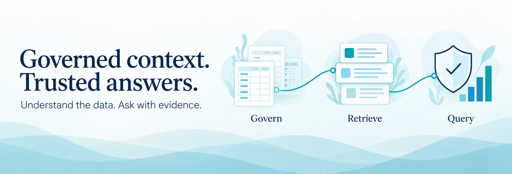
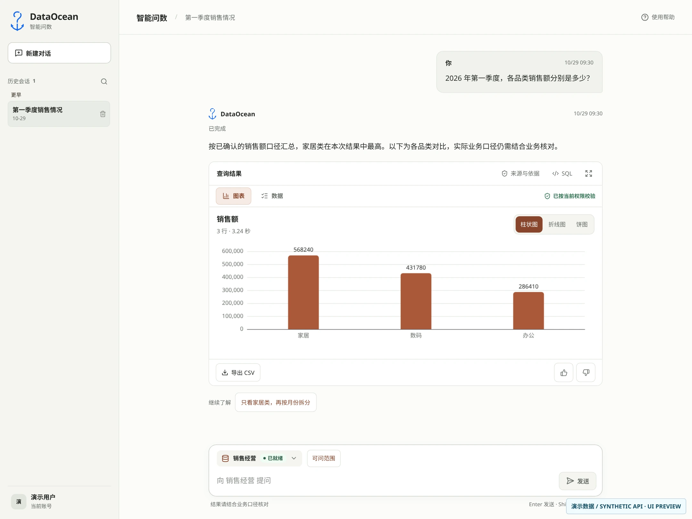
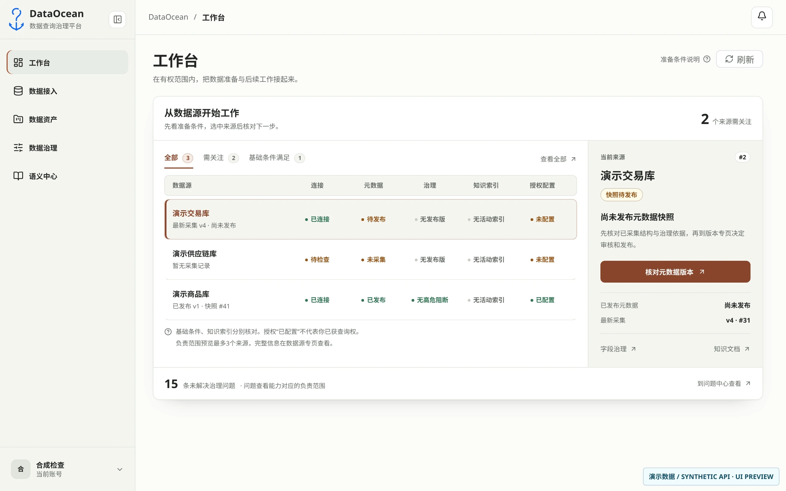
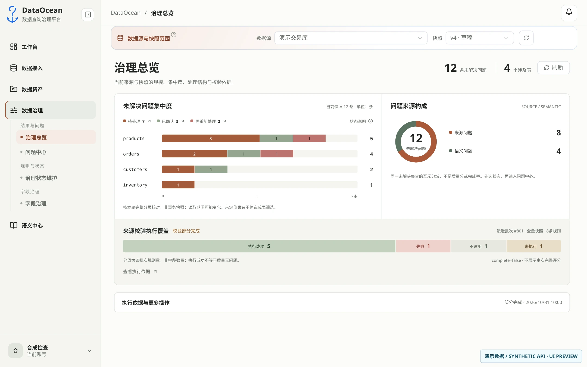
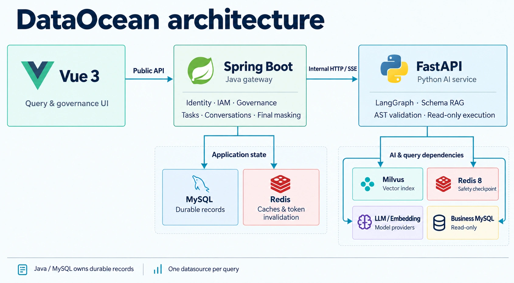
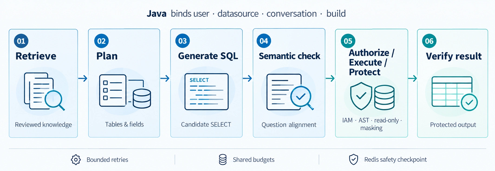
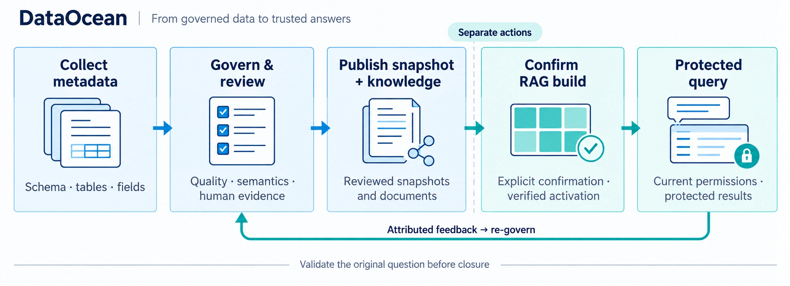

<h1 align="center"> DataOcean</h1>

<p align="center"><strong>面向企业数据场景的智能问数与数据治理平台</strong></p>
<p align="center"><strong>简体中文</strong> · <a href="README.en.md">English</a></p>
<p align="center"><a href="#product">产品预览</a> · <a href="#features">核心能力</a> · <a href="#architecture">系统架构</a> · <a href="#workflow">问数链路</a> · <a href="#quickstart">快速开始</a> · <a href="#docs">文档</a></p>



DataOcean 将自然语言问数（NL2SQL）与元数据治理连接起来。业务用户选择一个 MySQL 数据源，用自然语言查询同库多表；治理人员维护结构、业务含义和审核依据，系统据此交付受保护的表格、图表和查询依据。

> PC 桌面 · 当前面向本地开发与演示。实际验证范围与限制见[项目现状](docs/项目现状.md)。

<a id="product"></a>

## 历史界面预览（2026-11-02）

**问数工作区** · 在连续对话中阅读回答、表格与图表，按需查看 SQL 和来源依据。

[](docs/images/readme/query.webp)

| 工作台 · 来源准备 | 治理总览 · 问题分布 |
| :---: | :---: |
| [](docs/images/readme/workbench.webp) | [](docs/images/readme/governance.webp) |
| 聚焦具体来源的准备条件、阻断与有权下一步。 | 分开阅读问题分布、处理状态与来源校验覆盖。 |

点击图片查看全尺寸。以上为 **2026-11-02 的 Vue 组件＋合成 API 历史预览**，保留演示标记；界面为中文，不代表当前重设计样式或真实业务联调成绩。当前界面与验证范围见[全站重设计验收](docs/acceptance/2026-11-06-全站重设计与基础整治.md)。说明性图由内置 image 模型生成，未用于虚构产品界面。来源与版本见[资产说明](docs/images/readme/README.md)。

<a id="features"></a>

## 从提问到依据

| 能力 | 如何工作 |
| --- | --- |
| **自然语言问数** | LangGraph 编排检索、规划、生成和核对；支持连续对话、任务取消与恢复。图表不可用时可保留受保护表格。 |
| **Schema RAG** | 将经过审核的结构、字段解释、术语和业务知识用于检索；绑定数据源、快照与构建版本，并按当前权限筛选。 |
| **SQL AST 安全** | 使用 sqlglot 解析与校验，限制为安全的 SELECT；结合行列授权、参数化行条件、只读账号、结果上限与超时，再由 Java 最终脱敏。 |
| **治理与知识发布** | 从元数据采集、质量问题与语义补充，走到快照审核、知识文档发布和显式 RAG 构建；AI 候选与人工审核依据分开。 |
| **审计与血缘解释** | 保存查询尝试和来源证据，区分实体关系、查询使用与输出来源；反馈经归因进入再治理。 |

后台功能与负责数据源、业务问数的数据授权分别管理。后台能看到一个数据源，不代表当前账号就能查询它。详见 [IAM 与数据授权](docs/modules/007-iam-s1.md)。

<a id="architecture"></a>

## 系统架构



| 服务 | 职责 |
| --- | --- |
| **Vue 前端** | 问数、治理与管理界面；只调用 Java 公共 API。 |
| **Java 网关** | 身份、IAM、数据源、治理、审核发布、任务、会话持久化、审计和最终脱敏。 |
| **Python AI 服务** | LangGraph 编排、知识切分、Embedding、检索与重排、AST 校验、只读执行和图表生成。 |

Java/MySQL 保存完整会话与治理事实；Python 的 checkpoint 保存可恢复的安全图状态。图中省略授权、结果保护等内部回调。查询结果不缓存。完整依赖版本、存储归属和异步边界见[技术栈与模块职责](docs/技术栈与模块职责.md)。

<a id="workflow"></a>

## LangGraph 问数链路

Java 先绑定用户、数据源、会话与活动构建，Python 再依次完成 **检索 → 规划 → 生成 SQL → 语义核对 → 授权执行保护 → 结果核对**。



- **知识有来源**：检索绑定已审核知识及精确版本；候选与依赖还需满足当前 IAM 可见范围。
- **执行有保护**：每次候选 SQL 都重新授权，经 AST 校验、只读执行和 Java 结果保护后，才能进入结果核对。
- **修正有边界**：共享调用预算与时限；依据不足时澄清，服务故障明确失败。Redis 安全 checkpoint 不可用时停止问数。

这是核心链路示意，省略调度、澄清、失败与完成节点及部分分支。实现见 [graph.py](python-service/dataocean/iam_s1/graph.py)，完整合同见[问数与会话记忆](docs/modules/008-query-memory.md)。

<a id="governance"></a>

## 治理如何进入可信查询



**发布文档和构建索引是两个动作。** 构建固定来源、版本和知识集合，通过验证后才切换活动索引。查询固定本次 build，并在关键阶段复核来源和权限；反馈修订后，仍需按原问题核验才能结案。

血缘也区分用途：实体图表达已记录的结构或加工关系，查询追溯解释实际使用与输出来源。参与同一次 JOIN 不会自动变成物理数据流。详见 [Schema RAG](docs/modules/009-schema-rag.md)、[查询审计与血缘](docs/modules/011-audit-lineage.md)。

<a id="quickstart"></a>

## 快速开始

### 1. 准备环境

| 工具 / 服务 | 要求 |
| --- | --- |
| Java | JDK 17、Maven 3.6.3+ |
| Node.js | 22.x ≥22.18 或 24.x ≥24.11；npm |
| Python | Python ≥3.13、uv；下方命令使用 3.13 |
| 数据服务 | MySQL 8、Milvus、Redis；安全 checkpoint 需要具备 JSON/Search 能力的 Redis 8、DB 0 |

依赖要求与命令来源：[本地开发与验证](docs/development/本地开发与验证.md#工具与配置)、[前端锁文件](frontend/package-lock.json)、[Python 清单](python-service/pyproject.toml)、[Java POM](backend/DataOcean/pom.xml)。

```bash
git clone --branch develop --single-branch https://github.com/TTlook111/data-ocean.git DataOcean
cd DataOcean
```

已有基础依赖时填写实际连接信息；新环境可参考[可选 Compose 配置](docs/development/本地开发与验证.md#可选-compose-配置)。[docker-compose.yml](docker-compose.yml) 只提供依赖，三个应用在本机分别运行。

### 2. 配置与首次初始化

<details>
<summary>配置文件与首次初始化</summary>

首次克隆后，从仓库根目录创建本地配置；已有配置直接编辑：

```bash
cp backend/DataOcean/src/main/resources/application-local.example.yml \
   backend/DataOcean/src/main/resources/application-local.yml
cp python-service/.env.example python-service/.env
```

按[配置指南](docs/development/本地开发与验证.md#配置本机应用)填写实际连接、Java/Python 共用内部令牌、Java JWT 签名密钥与数据源加密密钥。真实密钥放在被忽略的本地配置或环境变量中。

Java 启动会应用 Flyway 迁移，请核对目标应用库。**新建空应用库**还需按[首次使用指南](docs/development/本地开发与验证.md#首次使用新建应用库)完成管理员密码与 IAM 初始化；已有环境使用原账号和授权。仓库不提供通用初始明文密码。

</details>

### 3. 启动三个应用

在三个独立终端中，分别从仓库根目录执行（Bash）：

```bash
# Java 网关 · 默认 8080
cd backend/DataOcean
mvn spring-boot:run
```

```bash
# Python AI 服务 · 默认 8000
cd python-service
uv sync --locked --python 3.13
uv run --locked uvicorn dataocean.main:app --reload --port 8000
```

```bash
# Vue 前端 · 默认 5173
cd frontend
npm ci
npm run dev
```

打开 <http://localhost:5173>。PowerShell 命令、端口调整和排障见[启动应用](docs/development/本地开发与验证.md#启动应用)。

### 4. 完成第一轮问数准备

1. 在后台 AI 配置中设置供应商、LLM 与 Embedding。
2. 接入使用**只读业务账号**的 MySQL 数据源，采集元数据并补充、审核业务含义。
3. 完成相应快照与知识文档发布，再由有权用户显式确认 RAG 构建。
4. 配置业务用户的问数功能与数据授权，选择有权数据源后提问。

应用能启动与当前账号可问数是两件事。准备状态、活动索引和个人数据权限需分别核验。

<a id="docs"></a>

## 文档与项目状态

| 想了解什么 | 入口 |
| --- | --- |
| 按目的查找文档 | [文档导航](docs/README.md) |
| 当前能力、验证范围与限制 | [项目现状](docs/项目现状.md)、[验收索引](docs/acceptance/README.md) |
| 环境、初始化、启动与测试 | [本地开发与验证](docs/development/本地开发与验证.md) |
| 架构与具体模块 | [技术栈与模块职责](docs/技术栈与模块职责.md)、[模块导航](docs/modules/README.md) |
| 页面交互与后续工作 | [前端开发规范](docs/development/前端开发规范.md)、[后续开发](docs/development/后续开发.md) |
| 参与代码修改 | [AGENTS.md](AGENTS.md) |

验收记录按环境、版本和覆盖范围阅读；定向页面检查与合成 API 预览不代表全项目生产验收。当前界面、基础修复与未测场景见[全站重设计验收](docs/acceptance/2026-11-06-全站重设计与基础整治.md)；[原 V3 验收](docs/acceptance/2026-10-31-工作台与治理总览V3.md)仅供追溯。

<details>
<summary>项目目录</summary>

```text
frontend/              Vue 问数端与治理后台
backend/DataOcean/     Java 网关、权限、治理与持久化
python-service/        LangGraph、Schema RAG 与 SQL 沙箱
docs/                  现行文档、开发指南与验收记录
docs/archive/          历史设计与预览，仅供追溯
specs/                 旧路径兼容入口，指向现行模块
```

</details>

## 许可证

[MIT License](LICENSE) · Copyright (c) 2026 Muyou (TTlook111)
