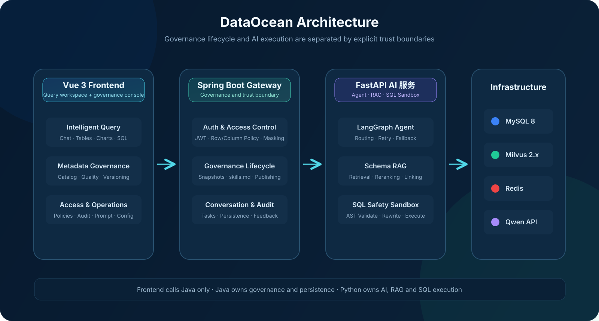
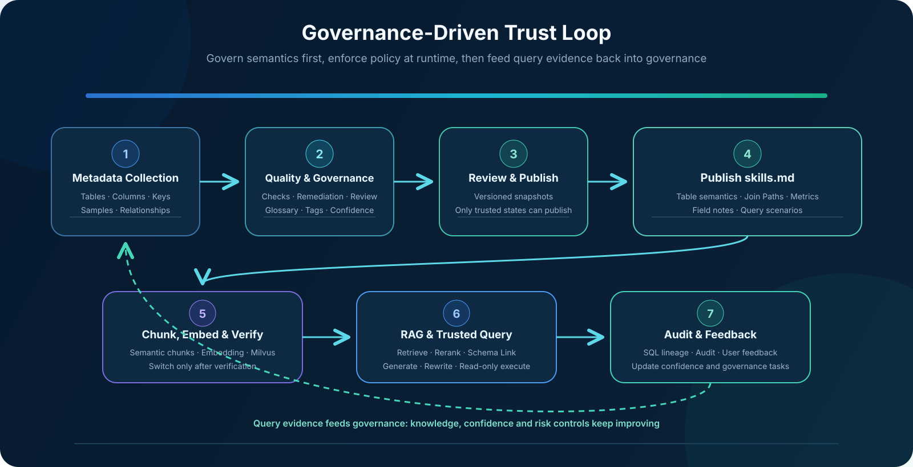

<p align="center">
  
</p>

<h1 align="center">DataOcean</h1>

<p align="center"><strong>元数据治理驱动的企业级 NL2SQL 智能查询平台</strong></p>

业务用户选择一个 MySQL 数据源，用自然语言查询同库多表；系统在可信元数据、当前权限和可审计执行链内生成 SQL，返回受保护的表格与图表。

## 核心能力

- 元数据采集、质量问题闭环、快照审核、术语、标签、字段可信度与语义知识。
- 文档审核发布与显式 RAG build 分离；绑定来源和版本，验证后切换活动索引。
- IAM-SIMPLE-1 功能与数据授权，候选 SQL 逐次授权、AST 校验、参数化记录条件和只读执行。
- S1 LangGraph 有界规划与修正，任务取消/恢复、会话历史、长期摘要及 Redis 安全 checkpoint。
- 查询审计、来源与血缘、最终脱敏、图表回退和反馈。

## 系统架构

<p align="center">
  
</p>

```text
Vue 3 查询端与治理后台
  → Spring Boot Java：身份、权限、治理、发布、任务、持久化与最终保护
  → FastAPI Python：S1 LangGraph、RAG、SQL 安全执行与图表
  → MySQL / Milvus / Redis / 模型供应商
```

前端只调用 Java；Java/MySQL 是会话和治理事实源；Python 不维护第二套完整聊天历史。详细版本、服务职责与异步边界见[技术栈与模块职责](docs/技术栈与模块职责.md)。

## 可信查询闭环

<p align="center">
  
</p>

元数据经过质量检查、审核和快照发布，再生成并审核发布 `skills.md`；有权用户显式确认 RAG 构建后，知识才进入活动索引。查询产生的字段使用、SQL 血缘、审计和反馈继续回流到治理侧。

## 快速开始

Java、Python 和 Vue 在本机运行。配置、首次初始化、启动命令与排障统一见[本地开发与验证](docs/development/本地开发与验证.md)，已有环境按该文档填写实际连接信息。

```bash
git clone https://github.com/TTlook111/data-ocean.git DataOcean
cd DataOcean
```

| 环境 | 内容 |
| --- | --- |
| 本机应用工具 | JDK 17 / Maven、Node.js / npm、Python 3.13 / uv；具体版本要求见启动指南 |
| 基础依赖 | MySQL、Milvus，以及具备 JSON/Search 能力的 Redis 8 checkpoint 环境 |
| 模型配置 | 启动后在后台设置供应商、LLM 和 Embedding；实际问数还需只读业务数据源、知识构建和数据授权 |

### 可选的依赖环境配置

如果尚未准备基础依赖，可以参考 [docker-compose.yml](docker-compose.yml) 和 [.env.example](.env.example) 一键准备 MySQL、Redis、Milvus 及其配套服务。具体配置方法见启动指南的[可选 Compose 配置](docs/development/本地开发与验证.md#可选-compose-配置)。

已有依赖环境的用户可以跳过 Compose。该文件只负责依赖环境，三个应用仍按启动指南在本机分别运行。

## 项目现状与文档

当前主链及 IAM-SIMPLE-1 已实现，已有本机真实/隔离验收记录；完整范围、未覆盖场景与剩余限制统一见[项目现状](docs/项目现状.md)。历史验收不代表当前机器或生产环境已验证。

| 需要的信息 | 入口 |
| --- | --- |
| 按目的查文档 | [文档导航](docs/README.md) |
| 当前架构与服务分工 | [技术栈与模块职责](docs/技术栈与模块职责.md) |
| 修改模块 | [模块导航](docs/modules/README.md) |
| 修改前端 | [前端开发规范](docs/development/前端开发规范.md) |
| 下一步任务 | [后续开发](docs/development/后续开发.md) |
| 验收范围与证据 | [验收索引](docs/acceptance/README.md) |
| 历史方案与规格适用性 | [历史材料](docs/archive/README.md)、[specs 索引](specs/README.md) |
| Agent 开发约束 | [AGENTS.md](AGENTS.md) |

## 项目结构

```text
frontend/              Vue 查询端与治理后台
backend/DataOcean/     Java 网关、权限、治理与持久化
python-service/        AI/RAG、S1 编排和 SQL 沙箱
docs/                  当前说明、开发指南、验收与历史归档
specs/                 原始规格与阶段契约，先看适用性索引
output/playwright/     本机原始验证输出，许多文件不纳入 Git
```

## License

本项目声明采用 MIT License；仓库暂未附带独立的 `LICENSE` 文件，许可证文本待补充。
