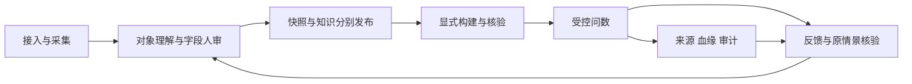

# 全站 V2 路由覆盖与跨页终验计划

2026-10-29，分支 `feat/frontend-conversation-v2-20261029`。起点 `a268531f97344e162d360d4bc49f564c596b2ea4`，最终代码提交与运行结果见[第九阶段验收](2026-10-29-全站收尾V2.md)。本表由独立只读 TypeScript AST 盘点与分阶段证据核对后更新：**42 records＝36个组件页＋5个redirect＋1个AdminShell布局**；`/admin`父布局与空子redirect是同URL两条记录。不能称42个独立页面。

所有正式组件页均已纳入第1–9阶段迁移和对应证据。下表“覆盖”表示已迁移且存在所列验证，**不表示每个内页的所有写分支、真实角色或真实后端均通过**。旧无引用Vue文件不当作新增正式页面；复用子组件按容器工作面盘点。

## 验收文档索引

| 代号 | 对应现行阶段验收文档（仓库根相对路径） |
| --- | --- |
| D1 | `docs/acceptance/2026-10-29-对话式问数V2.md` |
| D2 | `docs/acceptance/2026-10-29-后台与数据源V2.md` |
| D3 | `docs/acceptance/2026-10-29-采集与对象V2.md` |
| D4 | `docs/acceptance/2026-10-29-治理任务与字段审核V2.md` |
| D5 | `docs/acceptance/2026-10-29-版本与知识V2.md`（版本批次／知识批次） |
| D6 | `docs/acceptance/2026-10-29-血缘与审计V2.md`（A血缘、B查询分析、C操作审计） |
| D7 | `docs/acceptance/2026-10-29-治理工作面补全V2.md`（A–F） |
| D8 | `docs/acceptance/2026-10-29-权限与组织V2.md`（A–G） |
| D9 | `docs/acceptance/2026-10-29-全站收尾V2.md`（A–L；逐页及共享工作面） |

## 42条路由逐项矩阵

组件列统一省略`frontend/src/`前缀。类型来自实际record；箭头指兼容跳转或包装关系。

| # | 完整路径 | 类型 | 实际组件／跳转 | 阶段证据 | 当前文档覆盖及限制 |
| --- | --- | --- | --- | --- | --- |
| 1 | `/` | redirect | → `/query` | D1 | D9-L实际浏览器跳转通过 |
| 2 | `/guide/query` | 组件页 | `views/guide/QueryGuide.vue` | D9-H | 已完成迁移及对应批次独立审查；详见D9 |
| 3 | `/guide/admin` | 组件页 | `views/guide/AdminGuide.vue` | D9-I | 已完成迁移及对应批次独立审查；详见D9 |
| 4 | `/login` | 组件页 | `views/login/LoginPage.vue → views/LoginView.vue` | D9-E | E刚补记录：31项独立/6项合成浏览器；LoginPage包装LoginView |
| 5 | `/change-password` | 组件页 | `views/profile/ChangePassword.vue` | D9-F | 已完成迁移及对应批次独立审查；详见D9 |
| 6 | `/profile` | 组件页 | `views/profile/ProfileView.vue` | D9-G | 已完成迁移及对应批次独立审查；详见D9 |
| 7 | `/query` | 组件页 | `views/query/QueryDatasourceView.vue` | D1＋D6-A | 已有合成浏览器/定向验证文档 |
| 8 | `/query/iam-s1` | redirect | → `/query`，保留query | D1 | 保留query；D9-L实际兼容跳转通过，非新增页 |
| 9 | `/admin` | layout | `components/admin/AdminShell.vue` | D2-A | 共享布局；通知由D9-K补逐项证据 |
| 10 | `/admin` | redirect | → `/admin/workbench` | D2／D9-A | 空子路由重定向；不是第37页 |
| 11 | `/admin/workbench` | 组件页 | `views/AdminHomeView.vue` | D9-A | 已记7项合成浏览器及14项相关验证 |
| 12 | `/admin/data-sources` | 组件页 | `views/admin/datasource/DataSourcesView.vue` | D2-B | 列表/连接弹窗；保留浏览器PATCH未测限制 |
| 13 | `/admin/data-sources/:id` | 组件页 | `views/admin/datasource/DataSourceDetailView.vue` | D2-B | 就绪/详情/编辑；真实连接未测 |
| 14 | `/admin/collections` | 组件页 | `views/admin/metadata/CollectionsView.vue` | D3 | 任务＋同步计划两内页 |
| 15 | `/admin/assets` | 组件页 | `views/admin/assets/AssetsView.vue` | D3 | 已发布对象＋快照结构两内页 |
| 16 | `/admin/assets/lineage` | 组件页 | `views/admin/audit/DataLineage.vue` | D6-A | 关系图谱＋查询使用/输出来源 |
| 17 | `/admin/assets/entities/:entityId` | 组件页 | `views/admin/assets/AssetEntityDetailView.vue` | D3 | 六业务Tab及技术信息；非所有写分支都已逐项浏览器覆盖 |
| 18 | `/admin/releases` | 组件页 | `views/admin/releases/ReleasesView.vue` | D5-版本 | 列表/详情内容与操作记录/发布确认 |
| 19 | `/admin/releases/snapshots/:snapshotId` | 组件页 | `views/admin/releases/SnapshotDetailView.vue` | D5-版本 | 独立精确快照详情 |
| 20 | `/admin/releases/snapshots/:snapshotId/diff/:compareId` | 组件页 | `views/admin/releases/SnapshotDiffView.vue` | D5-版本 | 独立快照差异 |
| 21 | `/admin/governance` | 组件页 | `views/admin/governance/QualityDashboard.vue` | D7-A | 治理总览/来源覆盖/只读规划 |
| 22 | `/admin/governance/issues` | 组件页 | `views/admin/governance/IssueList.vue` | D7-A | 筛选/分派/逐条批量/依据/同表记录 |
| 23 | `/admin/governance/rules` | 组件页 | `views/admin/governance/QualityRulesView.vue` | D7-B | 配置/覆盖/目录/编辑/三详情Tab |
| 24 | `/admin/governance/rule-templates` | redirect | → `/admin/governance/rules`，保留query并置showChecks | D7-B | 保留query并加showChecks=1；非独立模板页 |
| 25 | `/admin/governance/status` | 组件页 | `views/admin/governance/StatusEditor.vue` | D7-B | 表列状态/批量/高影响确认 |
| 26 | `/admin/governance/fields` | 组件页 | `views/admin/governance/GovernanceFieldsView.vue` | D4＋D7-C至E | 五Tab全部已有映射；含两个旧记录折叠工作面 |
| 27 | `/admin/semantics/glossaries` | 组件页 | `views/admin/semantics/GlossariesView.vue` | D7-F | 分组/术语/聚合编辑/映射选择/审核历史 |
| 28 | `/admin/semantics/field-explanations` | 组件页 | `views/admin/semantics/FieldExplanationView.vue` | D4 | 候选草稿/人工审核/来源历史＋批量确认 |
| 29 | `/admin/semantics/knowledge` | 组件页 | `views/admin/semantics/KnowledgeView.vue` | D5-知识 | 全部文档/构建索引/审核队列及生成/构建窗口 |
| 30 | `/admin/semantics/knowledge/new` | 组件页 | `views/admin/semantics/KnowledgeDocCreateView.vue` | D5-知识 | 独立新建文档；非问数会话保存 |
| 31 | `/admin/semantics/business-knowledge` | 组件页 | `views/admin/semantics/BusinessKnowledgeView.vue` | D7-C | 与治理business Tab共用业务知识工作面 |
| 32 | `/admin/semantics/knowledge/:id` | 组件页 | `views/admin/semantics/KnowledgeDocView.vue` | D5-知识 | 六Tab与候选/版本预览/差异/回滚 |
| 33 | `/admin/semantics/prompts` | redirect | → `/admin/platform/prompts`，保留query/hash | D9-D | 保留query/hash至新平台路径；非第二个Prompt页 |
| 34 | `/admin/platform/prompts` | 组件页 | `views/admin/semantics/PromptsView.vue` | D9-D | 已记五Tab、D批47项及L锚点后48项相关/11项合成浏览器 |
| 35 | `/admin/access/iam` | 组件页 | `views/admin/access/IamS1AccessWorkspaceView.vue` | D8-A/B/C | 三个授权内页及脱敏候选 |
| 36 | `/admin/access/iam-approvals` | 组件页 | `views/admin/access/IamS1ApprovalView.vue` | D8-D | 本人申请/待审/已处理及资源/期限/确认 |
| 37 | `/admin/access/iam-organization` | 组件页 | `views/admin/access/IamS1OrganizationView.vue` | D8-E/F/G | 五Tab与用户、部门、角色、绑定、目录所有现有内页 |
| 38 | `/admin/operations/queries` | 组件页 | `views/admin/audit/QueryAnalysisView.vue` | D6-B | 查询审计/性能分析及按需详情/SQL |
| 39 | `/admin/platform/runtime` | 组件页 | `views/admin/system/RuntimeView.vue` | D9-B | 已记三Tab、14项相关/10项合成浏览器 |
| 40 | `/admin/platform/operation-logs` | 组件页 | `views/admin/system/OperationLogList.vue` | D6-C | 操作筛选/精确原记录/请求参数展开 |
| 41 | `/admin/platform/ai` | 组件页 | `views/admin/system/AiConfig.vue` | D9-C | 已记供应商/模型/参数/激活等；维度检测明确暂禁 |
| 42 | `/:pathMatch(.*)*` | 组件页 | `views/NotFound.vue` | D9-J | 已完成迁移及对应批次独立审查；详见D9 |

## 内部Tab、抽屉、弹窗与详情工作面

“已列”表示文档明确写出该能力/工作面及相关验证范围，并不自动表示所有成功、失败、权限和并发组合都在浏览器逐一操作。下表以实际组件为范围核对，避免只验顶层路由。

| 容器／内页范围 | 源码对应 | 文档收录 | 真实未测／不得外推 |
| --- | --- | --- | --- |
| 问数历史/新建、连续回答、composer；每回答图表/数据/SQL/CSV/反馈、大视图与来源依据弹窗 | `QueryDatasourceView`、`QueryAnswer`；依据中的attempt/hash由第六阶段补齐 | D1“实际改动/浏览器覆盖”；D6-A“单条问数依据” | 真实SSE、停止恢复、当前撤权、SQL/CSV二次服务端重验未在云端重跑；单条任务无投影状态就明确未提供 |
| 共享导航、折叠、ScopeBar、面包屑、账号菜单 | `AdminShell`、`AdminDomainNav`、`ScopeBar` | D2-A；后续各域范围用例与D8入口指引 | 壳交互6项不是所有公共浮层行为已验；所有屏幕阅读器/系统缩放未穷尽 |
| 通知弹出层：未读计数、8条列表、单读、当前列表批读、60秒轮询 | `AdminShell`→`useAdminNotifications` | D9-K：独立9+原壳8；合成浏览器6项，补列表/数量失败、重开浮层、身份晚回与卸载保护 | 真实用户归属/落库/长轮询未测；全局余数来自重读，不推定可见8条等于全部 |
| 数据源创建/编辑连接表单、密码省略/测试；详情六项就绪事实/有权下一步 | `DataSourcesView`、`DataSourceDetailView`及连接表单 | D2-B | 文档明确浏览器未实际提交编辑PATCH、未跑多页分页；真实连接未测。单测与可用保存按钮不抵真实编辑成功 |
| 采集任务Tab/发起表单/轮询/重试/快照入口；全局同步计划Tab/Cron/开关 | `CollectionsView`→`SyncTask`、`SyncSchedule` | D3逐项及映射 | 浏览器未跑多页采集分页、真实统计计算；真实调度/并发409/断线轮询/采样耗时未测 |
| 已发布对象/快照表结构两Tab、精确历史快照/字段定位与返回 | `AssetsView`→`TableExplorer` | D3 | 大快照、超长集合、任意规模遍历未测；搜索是返回集合内过滤 |
| 对象详情六业务Tab：字段、业务术语、标签与治理、所属与引用、血缘、下游影响；描述维护/标签动作及技术信息 | `AssetEntityDetailView`的`detailTabs`（表才有字段Tab） | D3明确保留全部分区；75项相关测试、29项浏览器列范围 | 已列功能不能写成六Tab所有写分支逐项浏览器成功；真实标签DELETE等文档明确未测。对象标签与字段标签是不同来源，勿混为同一删除API |
| 版本列表详情弹窗“版本内容/操作记录”、审核/门禁/发布/撤回确认；独立详情和差异路由 | `ReleasesView`、`SnapshotDetailPanel`、`ReleaseGatePanel`、`SnapshotDetailView`、`SnapshotDiffView` | D5-版本17项浏览器/64相关 | 真实发布/撤回、审计落库、跨客户端状态CAS未测；源/结构权限与版本权限分开 |
| 字段治理五Tab外壳、任务阶段/规则说明/发现/暂停/重试/复查/精确对象 | `GovernanceFieldsView`→`GovernanceWorklist` | D4，任务组合26项；其余Tab由D7补全 | D4不能单独证明内部business/tags/confidence/feedback全改；需联合D7。最小角色快照metadata辅助合同仍缺口 |
| 字段解释“候选与草稿/人工审核/来源与历史”、原始/当前解释、批量来源确认弹窗 | `FieldExplanationView`→`FieldSemanticWorkspace`、进度/历史组件 | D4全部点名 | 真实AI建议、资料真值、审核/批量部分成功落库未测；候选、保存、审核、复查、收录不可合并 |
| 治理总览的SOURCE/SEMANTIC、当前规划、历史评分、实际批次和覆盖；问题中心分派抽屉、语义依据、批量逐项回执、同表发布记录 | `QualityDashboard`、`IssueList` | D7-A | 同表记录不是单问题完整历史；关闭问题不等于原情景核验；真实检查/归因落库未测 |
| 规则源/全局模式、覆盖抽屉、检查项目录/编辑表单、详情“检查说明/执行记录/配置记录”；表/列状态及高影响确认 | `QualityRulesView`、`StatusEditor` | D7-B | 目标目录最近50预算不证明全量latest；规则/状态无客户端expectedVersion，预检不等于CAS；旧全局库不另算路由页 |
| business Tab及独立业务知识页：四类事实、AI/人工修订、来源对照/分页/hash、审核依据、历史、整组文档生成 | `BusinessKnowledgeWorkbench`、`GovernanceHistoryDialog`、`BusinessKnowledgeView` | D7-C，复用同一组件 | AI/资料真值及Java状态流转未测；生成草稿不等于发布/构建 |
| tags Tab：精确字段、预置/字段标签详情、批量新增、源级全版本模式打标确认 | `FieldTagManager` | D7-D | 没有虚构字段标签删除API；真实标签落库未测；模式覆盖本源所有采集版本，不是仅公共快照 |
| confidence Tab：当前修订档案/证据分页；折叠旧来源分列表、趋势和人工设置 | `GovernanceUsageProfiles`、`ConfidenceDashboard` | D7-D，趋势绘图及标签裁切小修另记 | 参考分不等于正确概率，0/null/失败不同；真实评分和旧分多客户端并发未测 |
| feedback Tab：实际targets归因、原情景固定标准/修复修订人工核验与历史；折叠旧反馈通过/驳回 | `GovernanceFeedbackQueue`、`FeedbackReview` | D7-E | 旧DTO无逐行source、旧approve/reject无客户端版本条件；只读粗入口+服务器逐条判权，不声称重复调整并发已解决 |
| 术语分组CRUD、定义/同义词、统一映射选择搜索分页、草稿/提交、审核依据、退回/删除、历史定义映射 | `GlossariesView`、`TermEditor`、`TermFieldPicker` | D7-F，21相关/6浏览器；级联删除文案单列 | 未绑定草稿允许；BROKEN/失效源仍由Java整体判权。真实级联删除/多角色及多客户端审核未测；分组无客户端版本条件 |
| 知识列表“全部文档/构建与索引/审核队列”、来源准备、整组生成、显式构建窗口 | `KnowledgeView`、`KnowledgeSourcePreview`等 | D5-知识 | 文档发布、快照发布、显式build、核验和活动索引分开；真实向量/指针切换/旧集合清理未测 |
| 知识独立新建；详情“内容/来源与覆盖/审核记录/版本/切分预览/索引状态”，AI候选、历史预览/差异/回滚、旧向量任务/表关联 | `KnowledgeDocCreateView`、`KnowledgeDocView`及候选组件 | D5六Tab明确保留、只读六Tab浏览器检查 | 六Tab只读浏览不等于每Tab所有写动作已逐项浏览器验收；真实来源hash/模型/向量核验未测；提交/审核/发布/回滚无客户端expectedVersion窗口保留 |
| 血缘关系画布/方向深度/对象列表、字段派生抽屉、关系创建/列映射/删除、批量导入、PNG；查询使用与输出来源及影响明细 | `DataLineage`、`QueryLineageEvidence`、录入组件 | D6-A | 不从共现推JOIN或物理流；只列历史覆盖、明细100/近期10任务；真实投影恢复/服务端列端点校验/大图未测 |
| 查询审计/性能分析两Tab；审计详情抽屉/按需二次读SQL，慢查询逐行打开审计证据 | `QueryAnalysisView`→`AuditLogList`、`SlowQueryList` | D6-B | 性能合并有权源，无伪单源筛选；审计SQL权与普通问数SQL权不同；真实审计/保护重验未测 |
| 操作日志高级筛选、原记录抽屉、请求参数按需展开 | `OperationLogList` | D6-C | 后端无独立详情接口，详情是本次行；参数不保证统一脱敏/完整性；无新导出/重跑 |
| 授权三个Tab：数据授权表单/撤销；字段保护及候选确认/拒绝；实际权限本人/他人 | `IamS1AccessWorkspaceView`→`IamS1DataGrantPanel`、`IamS1FieldProtectionPanel`、`MaskCandidatePanel`、`IamS1EffectivePermissionPanel` | D8-A/B/C逐项 | 实际管理资源辅助需permission:view缺口保留；无批量授权、无管理权代替查询权。保护写无客户端版本条件 |
| 访问申请“我的申请/待审批/已处理”、APPLY资源表单、子集/期限审批与精确确认 | `IamS1ApprovalView` | D8-D | 真实DENY/隐藏/废弃/阻断及临时grant落库、跨客户端竞争未测；不新增或改变30天上限 |
| 组织五Tab：用户详情/创建编辑/凭据一次展示/导入导出；部门树编辑；角色功能矩阵；用户角色绑定/逐源追加删除；只读功能目录 | `IamS1OrganizationView`、`UserList`、`DepartmentTree` | D8-E/F/G全部现有内页 | 目标管理账号隔离后端缺口、已有部门/父部门清null持久化风险、无CAS均保留；界面sys-only绑定范围不冒充Java完整角色分配能力 |
| 工作台待办、准备条件展开、可见活动、有权下一步 | `AdminHomeView` | D9-A已记录 | 只覆盖可见权限域；不把被裁剪0当全局0，真实后端聚合未测 |
| 运行监控“服务状态/SQL连接池/告警规则”、池重置确认、规则新建编辑/启停/分页 | `RuntimeView` | D9-B已记录 | 规则是CRUD配置，无新增删除、告警运行闭环/历史；真实池重置/健康和blind-toggle并发未测 |
| AI Chat/Embedding/active/pending/RAG事实、供应商折叠/新增编辑密钥、模型激活/测试同步/维度与参数 | `AiConfig` | D9-C已记录 | 维度检测明确暂禁，不算遗漏实现；全局pending完成激活写者、upsert原子create-only及真实供应商请求未验证 |
| Prompt“策略内容/审核流程/版本历史/调用记录/效果说明与历史统计”、合成校验、版本预览与回滚确认 | `PromptsView` | D9-D已记录 | 原目录只读100条，真实审核/CAS/模型/审计未测；回滚新草稿不立即激活 |
| 登录互动角色/验证码/显隐/键盘与重复提交、会话异步归属 | `LoginPage`→`LoginView`、auth/HTTP/guards | D9-E：31独立/6浏览器、构建及types/diff | 真实JWT/tokenVersion/验证码服务未联调；本次仅补读文档，没有冒称独立复跑这些验证 |
| 本人强制/普通改密；个人资料与异步保护 | `ChangePassword`、`ProfileView`、`AccountPage` | D9-F/G：联合独立17，浏览器8/7；包括安全退出、密码显隐重置、验证中换账号、明确放弃重读 | 真实改密/tokenVersion与本人资料落库未测；unknown锁仅本SPA/token |
| 问数/治理指南、有权入口；404返回导航 | `QueryGuide`、`AdminGuide`、`NotFound`、`GuidePage` | D9-H/I/J：独立导航6，浏览器5/4/4；390键盘/失败能力/合法返回 | 非真实后端多角色验收；指南不新造发布构建或自动审核能力 |
| 5条redirect完整目标、query/hash及showChecks | `router/index.ts`的5 records；Prompt页3处自有URL写入 | D9-L：实际Chromium5条逐一记录beforeResolve与最终URL；Prompt锚点补反例，相关48 | 记录重定向合同与目标页面后续URL分别取证，不把入口标志规范化混成丢参 |

## 仍未证明或明确未测

不存在仍待迁移的正式组件路由。以下保留为验收边界，不用截图或构建通过消除：

| 项目 | 当前证据与后续验证 |
| --- | --- |
| 数据源编辑PATCH、数据源/采集多页 | 阶段2/3明确浏览器未提交实际编辑PATCH、未走多页；相关前端单测和按钮可见不抵实际写成功。需在独立合成旅程及隔离后端分别补验。 |
| 对象与知识详情 | 已迁移并映射六业务Tab/六证据Tab，不能据只读Tab遍历推定标签DELETE、所有历史/候选/回滚写分支均已浏览器执行。原阶段逐项未测仍保留。 |
| 源/实体/快照/修订/hash/build/attempt真实合同 | 合成接口能证明前端传参与展示隔离，不能证明Java落库、Python模型/向量、最终SQL保护或投影恢复。 |
| 最小角色辅助读取 | 治理公共快照的metadata:view和IAM辅助目录的permission:view合同缺口显式保留；没有扩权、没有让无权辅助读取隐藏合法主读取。 |
| 后端并发和政策 | 保存/启停等无服务端CAS/幂等、管理账号目标隔离、主部门/父部门null持久化、DepartmentUpdateDTO默认启用、Chat写清pending、供应商upsert与维度检测问题按各阶段留存，未经授权不修后端。 |
| AI配置与Prompt | 未调用真实模型，未保存真实配置值/密钥。维度检测因provider归属未核验明确暂禁；Prompt列表原预算100条未改，不代表任意规模遍历。 |
| 大规模/无障碍/长期 | 大图、大快照、长会话、真实网络、全部屏幕阅读器/缩放/跨浏览器与长稳未穷尽。 |
| 附件交付 | 本机有真实Chromium合成API截图；Library旧上传审批待确认，本轮没有重试、换路上传或新ID。仓内只交付文本证据与脚本。 |

原18项治理失败属于早期冻结基线；第7阶段逐项修正fixture/矛盾断言，第8阶段独立复核未降强度。本轮另有旧工作台fixture缺真实IAM方法导致首次2失败，修复只补该方法且原7断言不改，实际最终结果见主报告，不把历史改成首次通过。

## 跨页完整模拟业务旅程终验计划

**这是待执行的统一状态旅程计划。** 本轮已运行各阶段独立浏览器回归和第九阶段检查，不能把它们相加宣称下述同一状态机的完整端到端旅程已经执行。统一旅程先使用全部拦截的合成Java API；随后在用户已有、经核验的隔离环境用相同业务资料另验真实Java/Python/数据库。不得连接生产、新建基础设施、自动merge或部署。

图示表达协作顺序，不新增RAG问数硬门禁；合法旧build与来源失效继续按原后端合同区分。

### 准备与取证

- 以本轮最终代码SHA创建验证记录，沿当前分支；不重设main。保留已发布旧build合法可用与来源失效两类状态。
- 一个统一fixture维护源1/源2、快照、表/字段、人工修订、文档版本/hash、构建成员、会话任务、PROTECTED attempt/SQL hash与反馈版本。每次写仅推进同一对象，不跨页各自硬编码“已就绪”。所有数据、凭据、模型状态标注合成。
- 身份按真实IAM摘要能力配置：接入/采集维护者、治理维护者、独立审核者、知识维护/审核者、业务问数者，以及最小只读/系统管理员无业务查询权反例。源功能必须在同一绑定命中，业务数据权独立；不从多个角色拼笛卡尔组合。
- 记录每一步发出的方法、路径、非秘密DTO、对象/源/快照/修订/指纹、确认前后与结果状态。密码/API key/JWT不进入日志；截图仍有“合成API”标识。每一步至少桌面与一个有意义窄屏、键盘焦点/错误恢复记录。

### 主旅程（顺序依赖）

| 步骤 | 页面/角色与动作 | 该步通过证据 | 下一步依赖 |
| --- | --- | --- | --- |
| 1 | 登录→工作台；分别进入有权角色，含首次改密 | 验证码/重复/角色落点正确；无查询权sys不显示问数入口；无权数据不请求、不造0 | 当前actor/token与能力摘要已核 |
| 2 | 数据源列表/连接表单→精确源详情，接入源1 | 连接测试与保存分开；创建/编辑不回显原密码，保存后负责源配置由真实合同决定；记录PATCH与返回对象 | 源ID/连接事实，不把连接成功当可问数 |
| 3 | 采集任务/同步计划→精确快照 | 运行、轮询/重试、成功快照入口、计划开关分别有回执；补多页；切源旧回包不更新源2 | 精确snapshotId与对象结构 |
| 4 | 对象目录/详情→字段治理/解释 | 来源注释、AI候选、人改草稿分开；晚AI不覆盖人工稿；人工核对用途/单位/依据 | 草稿保存修订/hash，非自动正式事实 |
| 5 | 独立审核账号审核/复查，问题中心核验SOURCE/SEMANTIC | 精确修订、负责源和状态；批量部分成功保留未完成；关闭问题不能替代原情景核验 | 已批准事实与质量问题实际状态 |
| 6 | 元数据版本详情/差异→审核发布 | 同快照门禁FAIL/WARN/读取失败合同；精确确认，不自动构建；旧版本撤回/来源失效另验 | publishedSnapshotId与有效来源 |
| 7 | 业务主题知识→候选/人工编辑→审核发布 | 文档复用对象事实；精确doc.version、来源hash和覆盖成员；409保稿；正文/来源6Tab逐项取证 | 文档已发布，不能当build完成 |
| 8 | 知识构建窗口→显式RAG任务/当前索引 | 确认快照/文档修订/hash/成员，有限失败恢复；新构建核验后切换，合法旧build及在途引用保留 | 精确build与来源有效状态；不新加askable硬门禁 |
| 9 | 业务用户问数→连续回答/SQL/CSV/来源 | 每问单源；阶段渐进；停/恢复/迟到包隔离；完成必须同任务PROTECTED attempt+匹配SQL hash；撤权重读受服务端保护 | 真实执行证据与结果，业务正确另人工判断 |
| 10 | 血缘/查询分析/操作审计 | JOIN关系、加工血缘、实际使用与输出来源分开；成功结果不当投影完成；空/失败/无权/投影待完成各有截图 | 精确实体与同任务证据，不从共现推边 |
| 11 | 问数反馈→归因/人工修订→原情景核验 | targets归属、固定原筛选与预期、修复修订、409/未知保留；使用分/正反馈不自动批准语义 | 需修订时重新经过4–8，不自动奖励/发布 |
| 12 | 通知/账号/指南/404与跨工作区返回 | 可见批读不归零全局；旧账号单读不跟进新账号；资料明确放弃可核对、forced可安全退出；5redirect保参、404有权落点 | 本次旅程收尾，不能留下未知写却宣告全成 |

### 对抗分支与完成标准

- 在每个有异步读取/确认/写入的工作面注入：源1→源2、A→B、对象/快照/修订变更、早发晚回、双击、取消确认、409、5xx/断网导致结果未知、无权辅助读取；验证不泄露旧数据、不重发未知写、不用空/0冒充失败。
- 治理审核、发布、RAG构建和权限授予分别测试最小有权与无权账号；认证/权限/数据库政策若需变更先独立报告待确认，不以扩大fixture或前端门禁补洞。
- 保存前后、抽屉打开/关闭、浏览器刷新/前进后退、筛选分页、图节点定位/返回、停止/恢复必须保精确上下文；后台ScopeBar不得向不支持的目标带旧snapshot/tab。
- 必须单列每项：通过/失败/阻塞/未测及证据。仅全部计划必测项已执行、失败复验闭环、未知写已核对，才称“统一合成旅程通过”；真实服务旅程另独立确认。构建/单测/截图数量都不单独构成业务验收。
