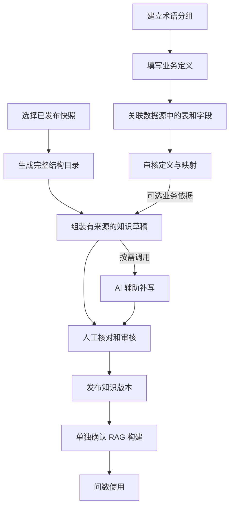

# 业务术语与语义知识改造方案

> 历史参考／非现行合同；现行依据见文档导航。


> 文档类型：已批准并实施的修改方案；编写日期：2026-10-17；完成核对日期：2026-10-18；工作树基线：`cbb7e9a`。本次状态为“修改完成，核心流程验收通过”。用户已批准开发，并分别授权隔离库 V65 迁移、正式 Browser 运行文件修复及新 RAG 构建验收。详见[项目现状](../../../项目现状.md)与[验收结论](../../../acceptance/业务术语与语义知识验收记录.md#验收结论)。

## 1. 要解决的问题

用户希望知道：一个术语表达什么业务含义、对应哪个数据源的哪些字段，以及维护后如何影响知识生成和问数。

当前页面把定义、字段关联和审核拆在不同位置，知识生成又没有接入术语输入，导致用户容易把术语当成普通文字登记。此次改造将这几个动作串成清楚的流程，同时保留草稿和渐进完善能力。

目标流程：



允许术语先保存为未关联草稿；允许没有术语时先生成结构目录。两者均不要求用户提前建设完整术语库。

## 2. 改造前实现与差距

下表保留方案编写时的差距，供核对改造目标；不是实施后的当前状态。Browser 已按用户授权从正式安装包修复，后续真实验证范围见验收记录。

| 核对对象 | 当前实现 | 需要修改 |
| --- | --- | --- |
| 术语分组 | 页面叫“术语表”，包含名称、显示名、描述；不绑定单一数据源 | 显示为“术语分组”，说明分组、术语与数据库表的关系 |
| 新增术语 | 表单只有名称、定义、同义词等文本 | 将字段关联放入同一维护流程 |
| 字段关联 | 保存后选中术语，在详情的审核记录下方打开关联弹窗；弹窗才选择数据源 | 提前展示关联状态，按数据源、表、字段逐级选择 |
| 字段候选 | 读取数据源实体后在前端过滤列，最多展示过滤结果的前 50 条 | 服务端按数据源和表过滤、分页；失败与无结果分别显示 |
| 审核与映射 | 定义编辑有状态门禁；关联、解除字段没有完整复用定义变更的状态门禁 | 定义与映射纳入同一个修订和审核范围 |
| 审核意见 | 术语审核原因只写服务日志，没有形成页面可读取的审核意见记录 | 持久化审核意见及其对应的修订 |
| 知识草稿 | 页面调用快照目录生成，结构事实由程序整理；缺少业务释义时待确认 | 保留完整目录，接入已审核术语，再提供独立的 AI 补写动作 |
| 术语与知识 | 问数有单独读取已审核术语的链路；知识生成请求未包含术语 | 增加可追溯的术语输入，不能只把术语文本拼进 Prompt |
| 知识事实 | 校验与切分支持结构、注释、关系、血缘等现有类型 | 扩展术语事实及人工确认语义事实的校验、切分和构建支持 |

实现入口：[术语页面](../../../../frontend/src/views/admin/semantics/GlossariesView.vue)、[术语接口](../../../../backend/DataOcean/src/main/java/com/dataocean/module/glossary/controller/GlossaryController.java)、[术语状态流转](../../../../backend/DataOcean/src/main/java/com/dataocean/module/glossary/service/impl/GlossaryTermServiceImpl.java)、[知识生成编排](../../../../backend/DataOcean/src/main/java/com/dataocean/module/knowledge/service/impl/KnowledgeDocPublishService.java)、[Python 草稿生成](../../../../python-service/dataocean/knowledge/service.py)。旧注释中的“AI 一键生成”不能作为当前页面已经调用模型的证据。

## 3. 范围和边界

### 3.1 本次规划的范围

- 完善术语分组、术语定义、字段映射、审核和状态反馈。
- 将已审核且适用当前数据源、快照的术语接入知识草稿生成。
- 在完整结构目录之外，提供可选的 AI 业务释义草稿及人工确认流程。
- 补齐来源冻结、事实校验、版本依赖与相关权限、并发验证。

### 3.2 保持的边界

- 术语按业务概念建立，一张表可以关联多个术语；同义的概念可以映射多个字段。术语分组可以跨数据源，字段映射按数据源展示。
- 每份知识版本绑定一个数据源和明确的元数据快照；一次问数只选择一个 MySQL 数据源，不能因共用术语引入跨库 Join。
- 术语定义帮助理解业务，不自动成为数据库约束、权限规则或已验证的指标公式。本次不新建指标计算引擎或任意 SQL 编辑入口。
- Java 负责身份、IAM、治理、审核、版本、持久化和构建状态；Python 负责生成、切分、向量及查询执行。前端只调用 Java。
- 沿用七域侧栏、海蓝视觉、现有组件和标题右上角说明入口。对象关联状态与阻断原因直接显示，不把关键下一步只放进问号说明。
- 知识文档发布和 RAG 构建确认始终分开；生成或审核术语不自动发布文档、切换索引或触发问数。

## 4. 术语维护流程

### 4.1 分组与列表

页面标题仍为“业务术语”，“新建术语表”和左栏标题调整为“新建分组”“术语分组”。分组创建只填写业务分组信息，不强制绑定数据源；不改既有数据库表名或路由来实现文案调整。

术语列表展示业务名称、简短定义、审核状态、已关联的数据源和字段数量；FQN 等技术标识放入详情中的按需展开区域。关联信息受当前管理范围过滤，不能通过数量或名称泄露无权数据源。

分别展示“未关联字段”“已关联 N 个字段”“关联已失效”和审核状态。没有映射时不显示“问数可用”；有映射且审核通过也不能替代数据源 readiness 或当前用户查询权限。

### 4.2 新增和编辑

在现有工作区中使用统一的术语维护面板，不增加一级或二级导航。面板依次提供：

1. **业务定义**：业务名称、同义词、定义与口径说明；内部标识在需要时维护，避免用户先面对两组含义不清的名称输入。
2. **关联字段**：选择数据源，再选择表和字段；展示中文说明、表名、字段名、类型及已选路径，允许分组添加多条映射。
3. **核对与保存**：展示定义、已选映射和缺失项，提供“保存草稿”“保存并提交审核”。

不要求先保存才能开始挑选字段。用户也可以暂不关联，保存后明确提示“草稿已保存，尚未关联字段”，并保留继续关联入口。提交审核前检查定义完整性与映射有效性；缺少字段的概念草稿继续保留，不能被包装成可定位 SQL 字段的已审核术语。

字段候选仅来自有权管理的数据源与正式快照；禁用、废弃或来源失效的对象不可新增关联。加载中、无数据源、无表、无字段、无权和请求失败分别反馈。候选分页和搜索由服务端完成，不能静默截断前 50 条。

### 4.3 详情与审核

详情顺序调整为：业务定义和同义词 → 关联字段与缺失项 → 当前允许的操作 → 审核记录 → 技术标识。

审核页同时展示定义和完整映射，并指出相对上一次审核的变化。审核意见需要可读、可追溯；产品页面不展示数据库列缺失、内部关系类型、服务日志等实现说明。

沿用现有状态机：

```text
DRAFT / REJECTED → PENDING_REVIEW → APPROVED
                         ↓ 拒绝
                      REJECTED
APPROVED → 显式退回草稿 → 修改定义或映射 → 重新提交审核
```

待审核和已通过状态都不允许直接修改定义、关联或解除字段。映射失效时显示原因，阻止把原审核结论直接用于新知识生成；修复后重新审核。

### 4.4 保存、权限和并发

- 一个保存动作提交术语内容和映射集合，由 Java 在同一事务中校验并保存；字段关联失败时不留下“文字已创建、关系只保存一部分”的假成功。
- 草稿聚合增加修订号。保存、提交、审核、退回和映射修改使用一致的并发检查；审核结果只能作用于审查时的同一份定义与映射。
- 现有独立关联、解除和更新接口必须经过同一状态与并发校验，不能只把新页面做正确而保留绕过入口。重复提交同一内容不能产生重复关系。
- 保存前检查既有映射涉及的全部管理范围及新目标真实归属。继续使用 S1 现有功能与负责源校验，不把多个角色绑定的功能和数据源交叉组合。
- 未关联草稿按现有全局功能边界维护；增加字段映射后按真实关联源校验。前端选择的数据源只用于操作上下文，不能作为授权事实。
- 审核快照持久化修订号、定义、完整映射、内容摘要、审核人员、时间及意见。具体持久化变更随阶段 A 一并评审，不以日志或 `updatedAt` 代替版本证据。

## 5. 知识生成依赖

### 5.1 改造前输入与本方案处理

| 输入 | 当前情况 | 本方案的处理 |
| --- | --- | --- |
| 数据源、元数据快照 | 已指定，表字段来自同一快照 | 继续固定数据源与已发布快照，生成前展示名称和版本 |
| 表、字段、类型、主键、注释、治理状态 | 已进入生成请求 | 由程序生成完整结构目录；原始注释不能直接等同于已确认业务口径 |
| 字段标签、可信度、索引标记 | 已在部分请求字段中传输，并非都被当前目录渲染使用 | 逐项确认输出用途，不能只因请求中有字段就宣称已生成相应知识 |
| 表关系 | 已读取关系类型和审核状态 | 可靠关系和待确认候选分开；不把命名相似或候选关系当作业务 Join 依据 |
| 血缘、派生关系 | 读取已确认且绑定所选快照的事实 | 保留来源；血缘关系不能自动当成可执行 Join |
| 术语定义、同义词、字段映射 | 尚未接入知识生成 | 引入适用于本次数据源、快照的已审核修订及完整依赖 |
| 指标公式、筛选规则、枚举解释、查询样例 | 当前没有完整的结构化生成输入 | 有经审核来源时纳入；缺失时待补充，不由 AI 猜测后直接发布 |
| 业务数据样本 | 当前主入口未读取业务行作为生成输入 | 本次不新增自动采样或向模型发送业务行数据 |

没有术语时仍可生成目录。存在不合规术语时展示排除项与原因，用户可以明确选择仅生成结构目录，不能把读取失败显示成“0 条术语”。

### 5.2 生成前核对

保留“生成快照目录”入口；在已有文档中增加明确的“AI 辅助补写业务释义”动作。生成前展示：

- 本次数据源、来源快照、表字段覆盖范围。
- 拟使用的已审核术语及其字段映射、修订信息。
- 已确认关系和血缘；缺失的业务解释及被排除来源的原因。
- 本次是生成结构目录还是调用 AI 补写，是否会创建新的草稿版本。

普通用户看到业务名称、快照版本和缺失项；hash、内部 ID 等放在来源详情中。重新生成只能写入新的草稿版本，不能静默覆盖人工修改或已发布版本。

### 5.3 固定生成输入

Java 收集并冻结本次输入清单：数据源、快照、术语修订和审核快照、定义与映射摘要、关系来源及资源依赖。Python 使用这一份输入生成，不自行读取另一套术语或权限数据。

术语映射必须解析到所选快照的真实表字段，不能只凭字段名相同认定有效。概念可以跨源复用，但本次输入只包含适用当前数据源的事实；如果裁剪后不足以表达完整业务条件，就排除该规则并提示缺失，不能把不完整依赖伪装成本源可执行规则。

完整覆盖要求继续保留。禁用、废弃对象的覆盖情况作为单独的治理核对清单记录，不送入 AI 语义补写，不进入检索或 SQL 证据；该分离需要与现有完整覆盖、发布校验一起对齐，不能通过删除覆盖检查或放宽治理门禁完成。

### 5.4 结构目录与 AI 补写

**结构目录**由程序生成，固定表字段 ID、类型、主键和来源。文档体系覆盖全部绑定对象，可以按域或表拆分，不能只选择“常见字段”替代完整覆盖。

**AI 补写**只针对有明确资源依赖的业务解释、术语说明和查询场景候选。模型不能改写结构事实、增加不存在的字段或把未经确认的关系补成 Join。大快照按表或业务域受控分批处理，保留覆盖清单，避免靠缩减字段清单适配上下文。

AI 输出先作为待确认内容展示。人工需要核对定义、字段取值及条件，补足可追溯来源；不能仅把 AI 自报的 `APPROVED` 当作审核。没有依据的公式、状态含义和场景继续保持待确认。

AI 超时、欠费、限流或解析失败不影响已经生成的结构目录。页面明确提示“目录已生成，业务释义补写失败”及重试入口；不能把部分结果提示为全部成功。AI 配置继续由后台管理，缺少配置不阻止应用启动和结构目录生成。

## 6. 事实、版本与问数衔接

术语接入不能止于 Prompt。需要同时改造以下链路：

1. **来源表达**：新增可识别的术语事实与人工确认语义事实，记录审核快照、修订、内容摘要、快照 ID 和全部表字段依赖。
2. **Java 校验**：扩展 `KnowledgeSnapshotFactValidator`，验证来源存在、审核有效、内容和映射未变化、依赖属于同一数据源与快照。未知类型、伪造审核或混合快照继续拒绝。
3. **Python 切分**：扩展事实类型到 chunk 类型的映射，保留来源、审核状态和完整资源依赖；待确认片段不能成为已审核的 SQL 证据。
4. **发布与构建**：知识版本保存不可变输入清单。发布和新 build 确认时复查术语来源，冻结确切版本及 chunk membership；不能在构建过程中重新拼接“最新术语”。
5. **变更影响**：来源术语修改、撤回、删除或映射失效时，显示受影响知识及需重新确认的原因；不静默重写已发布版本。新构建不得继续使用失效事实，后续检索也要过滤已失效的来源事实。
6. **问数保护**：术语直接读取链路与 RAG 使用一致的来源有效性和当前资源过滤规则。不能通过“已审核术语”携带撤权字段，也不能放宽 SQL AST 校验、Java 最终保护或完成合同。

既有活动 build 和在途 collection 按引用生命周期保留，来源失效不能通过直接删除 collection 处理。只有新构建校验通过后才切换活动指针。此阶段需要实际核对 Java manifest、Python chunk metadata 与检索过滤，不能仅修改文档状态。

相关现行边界见[知识模块](../../../modules/006-knowledge.md)、[RAG 模块](../../../modules/009-schema-rag.md)、[问数与记忆](../../../modules/008-query-memory.md)。

## 7. 实施分期

| 阶段 | 交付范围 | 完成后用户能做什么 | 进入下一阶段的条件 |
| --- | --- | --- | --- |
| A：术语维护 | 分组命名、统一维护面板、分级字段选择、聚合保存、修订审核和意见持久化 | 独立完成一条术语的定义、关联和审核；看懂未完成项 | 状态、权限、并发和真实操作链通过 |
| B：术语进入知识目录 | 输入核对、审核来源冻结、同快照映射、事实校验、切分及构建衔接 | 知道本次目录用了哪些术语，追溯到审核来源 | 版本固定、来源变更、权限过滤和 build 生命周期通过 |
| C：AI 辅助补写 | 独立补写动作、按来源生成候选、差异核对、人工确认和失败恢复 | 在可靠目录上补充业务解释，逐步完善知识内容 | 真实供应商成功与失败、未确认内容隔离均有证据 |

阶段 A 不依赖模型供应商可用；阶段 B 的结构目录路径也不依赖 LLM。阶段 C 必须有真实生成验证，不能以历史记录或代码存在标记完成。

实施结论：A/B/C 的功能修改及本次隔离单源核心流程验收已完成。真实供应商成功/失败、人工采纳、知识发布、新 build、无在途引用的旧集合清理、受保护问数及历史重读均已有证据。各轮结果统一维护在[验收记录](../../../acceptance/业务术语与语义知识验收记录.md)；跨源、双用户、大快照和在途引用等未覆盖场景统一维护在[后续开发](../../../development/后续开发.md#6-扩展术语与知识边界验证)。上表的分期条件与第 8 节标准保留作为设计和验证依据，不将本次核心流程通过写成全部场景通过。

### 7.1 主要改动位置

| 层 | 改动位置和责任 |
| --- | --- |
| 前端 | `GlossariesView.vue`、`glossary.ts`：维护与字段选择；`KnowledgeView.vue`、`KnowledgeDocView.vue`、`knowledge.ts`：输入核对、生成结果与来源查看 |
| Java 术语 | `GlossaryController`、术语 Service/Mapper：聚合事务、修订、统一状态门禁、审核快照与意见；实体查询复用目录能力并校验真实归属 |
| Java 知识 | `KnowledgeDocPublishService`、`KnowledgeDependencySnapshotBuilder`、`KnowledgeSnapshotFactValidator`、生命周期与 build Service：固定输入、事实校验和来源变化处理 |
| Java 问数 | `IamS1QueryServiceImpl` 中的已审核术语读取：与新修订和映射约束对齐，维持当前权限过滤 |
| Python | `knowledge/schema.py`、`knowledge/service.py`、知识路由、`rag/chunker.py`、S1 检索过滤：输入契约、候选生成、来源 metadata 与过滤 |
| 数据持久化 | 最小新增术语修订、不可变审核快照与意见，知识版本的术语依赖清单；优先复用既有知识版本和依赖快照能力，不建第二套知识库 |

新增 Java 请求、查询和返回对象分别放在 `entity.dto`、`entity.query`、`entity.vo`；分页查询继承现有 `PageQuery`，排序字段使用白名单。公共接口保留 `/api/admin/*`，Python 内部接口保留 `/internal/*` 及共享令牌保护。Java/Python 调用继续使用现有 client、RestClient 与适用的重试约定。

实施时已核对最高占用版本并新增 V65；V53 永久不用。用户授权的隔离库已迁移，其他库不自动迁移。不创建数据库外键，不改写历史审核状态或补造字段关联。既有术语保持原状；无法证明其历史审核覆盖完整映射时，标记需要重新确认，再进入新知识生成流程。

## 8. 验收标准

### 8.1 术语体验与状态

- 新用户无需额外口头解释，可以建立分组、填写术语、选择数据源/表/字段并提交审核。
- 未关联术语能保存草稿；保存后下一步明确，不显示成问数可用。
- 支持同一术语关联多个同义字段；列表与详情显示真实名称和映射状态。
- 候选超过 50 条仍可完整查找；请求失败不会显示成正常空列表。
- 定义与映射保存失败整体回滚；无权目标不产生任何部分写入。
- 待审核、已通过状态的直接更新及旧关联接口绕过均被后端拒绝；并发保存或审核不会覆盖另一修订。
- 审核意见可读；审核界面能看到与本次结论一致的定义和映射。

### 8.2 知识生成与来源

- 无术语、无 AI 配置时仍可生成完整结构目录；真实输入和覆盖范围可以核对。
- 只纳入适用于所选源和快照的合规术语；未审核、撤回、无权、错误快照及依赖不完整的来源有明确排除原因。
- 原始注释与 AI 推测不冒充已确认口径；伪造事实类型、来源 ID、hash 或审核状态被拒绝。
- 草稿、人工修改、已发布版本相互隔离；重新生成或补写不覆盖已有审核结果。
- 术语变更后，旧版本来源仍可追溯，失效事实不会被新构建或后续检索继续使用。
- 文档发布不自动构建索引；新构建失败不切换活动指针，不提前删除在途 collection。
- AI 补写失败保留结构目录并展示真实失败；重试不产生重复版本或重复采纳。

### 8.3 验证与证据

- Java 定向验证聚合保存、事务回滚、修订审核、S1 管理范围、事实校验及构建生命周期。
- Python 定向验证输入清单、目录完整覆盖、事实切分、未确认片段隔离及来源/权限过滤。
- 前端验证关联选择、状态流转、失败恢复、权限提示、窄屏和键盘操作。
- 正式 Browser 可用后完成真实创建、关联、审核、知识生成操作，证据保存到 `../../../output/playwright`，注明环境、代码版本及未覆盖场景。
- 涉及迁移时单独核对经确认的 MySQL 测试环境；H2 或 Flyway-disabled 测试不能证明迁移成功。复用现有基础设施，创建、重置及迁移继续遵守仓库授权边界。

## 9. 文档维护与评审重点

实施后按职责更新[前端规范](../../../development/前端开发规范.md)、[知识模块](../../../modules/006-knowledge.md)、[RAG 模块](../../../modules/009-schema-rag.md)及[项目现状](../../../项目现状.md)；剩余工作统一维护在[后续开发](../../../development/后续开发.md)。本方案中的目标行为在实现和验证前不写成现行能力。

本轮优先评审：阶段 A 的统一维护流程、未关联草稿与审核边界、定义和映射同时审核、阶段 B 的来源冻结与失效处理。阶段 C 采用独立 AI 补写动作，不恢复无来源的自由生成，也不把术语建设设为目录生成的前置门槛。
