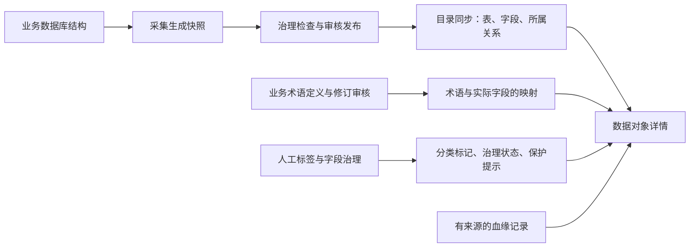

# 数据对象目录与详情完善方案

> 文档类型：已实施方案归档；原整理日期：2026-10-18；归档整理日期：2026-10-21。主体代码修复与布局实施已有记录，后续人工验收、边界复核和独立扩展不在此重新组织开发。
> 适用范围：数据对象目录、表与字段详情、术语与标签关联、发布后的目录同步和血缘绑定。
> 本文保留实施设计、理由和原始验证边界，不作为当前执行计划或全量验收结论。当前行为以[模块说明](../../modules/003-metadata-collection.md)和[前端规范](../前端开发规范.md)为准；验证范围由[项目现状](../../项目现状.md)维护，未完成事项由[后续开发第 7 项](../后续开发.md#7-数据对象目录的剩余验收与边界复核)维护。归档不表示第 6.6、6.7 节的页面人工验收及第 12 节边界已全部通过。

## 1. 这部分要解决什么问题

数据对象目录是一份可检索的数据库对象说明书。用户从这里找到表和字段，了解它们在哪里、已有说明是什么、受到哪些使用限制，以及与哪些业务概念和其他对象有关。

它展示的是元数据和业务关联，不是数据库业务明细。字段的一条目录记录不是一条订单或商品记录；字段说明也只是对象信息的一部分。

完善后的工作路径应当是：

```text
选择数据源 → 找到表 → 查看字段 → 理解原始注释与业务术语
                                → 查看标签、治理状态与保护提示
                                → 查看血缘与下游影响
                                → 在有权限的对应工作区维护 → 返回原目录位置
```

本轮首先保证关联正确、来源明确，再调整信息层级和布局。不通过增加空卡片、复制术语记录或编造业务说明来补齐界面。

## 2. 给谁使用

下表描述使用场景，不代表新增系统角色或默认授予权限。实际访问和操作仍由现有 S1 能力及负责数据源范围决定。

| 使用者 | 主要问题 | 目录和详情应提供的帮助 |
| --- | --- | --- |
| 数据维护人员 | 哪张表、哪个字段是我要找的？来源是否正确？ | 对象检索、所属位置、技术属性、来源快照 |
| 业务术语维护人员 | 这个业务概念对应哪些实际字段？ | 从字段反查术语，并定位到术语定义和映射维护 |
| 数据治理人员 | 有哪些分类、质量或使用限制？ | 标签来源、治理状态、保护候选及对应维护入口 |
| 审阅人员 | 当前看到的信息是否有可核验的依据？ | 发布状态、实际来源、审核有效性、失效原因 |
| 有目录查看权限的分析人员 | 这个字段是什么意思，适不适合当前分析？ | 原始注释、业务定义、关联关系和明确的限制说明 |

能查看目录不自动意味着能维护术语、取消标签、查询业务数据、查看血缘或确认脱敏策略。

## 3. 核心概念与职责

| 内容 | 回答的问题 | 示例及边界 | 主要维护位置 |
| --- | --- | --- | --- |
| 数据源 | 从哪个数据库接入？ | 一个已配置的业务数据库连接 | 数据接入 |
| 表 | 数据按什么结构组织？ | 订单表、商品表 | 采集快照与版本发布 |
| 字段 | 表里具体存了哪一项？ | 购买数量、商品单价 | 采集快照与字段治理 |
| 原始注释 | 源数据库已有怎样的说明？ | 字段备注“购买数量” | 来源元数据；不等同于已审核业务口径 |
| 业务术语 | 业务上如何理解、适用什么口径？ | 销售额、已完成订单总笔数；一个术语可关联多个字段 | 语义中心的业务术语工作区 |
| 标签 | 对象属于哪类、具有什么特征？ | 金额类、时间类、敏感信息 | 既有标签与治理流程 |
| 治理状态 | 当前有哪些使用限制？ | 正常、废弃、阻断 | 数据治理及发布流程 |
| 所属关系 | 对象位于什么层级？ | 数据源包含表，表包含字段 | 发布同步生成的结构关系 |
| 外键关系 | 数据库记录了什么引用约束？ | 订单商品编号引用商品编号 | 采集和关系治理；不自动成为已批准业务 Join |
| 血缘与下游影响 | 数据从哪里派生，变化会影响哪里？ | 表级血缘、字段派生 | 既有血缘记录及确认流程 |

业务术语不是字段注释的另一份副本，也不要求一个术语只对应一张表。术语定义、字段映射和审核应当保持同一修订下的一致性。

“敏感”标签不等于已经执行脱敏；保护候选不等于生效策略。即使存在跨源血缘，问数仍遵循一次选择一个数据源、Join 限于该数据库的边界。

## 4. 信息从哪里来

### 4.1 结构与业务解释分开产生



采集成功只表示形成了快照，不代表已经发布、已经完成业务解释或已经进入 RAG。快照发布、知识文档发布和明确确认 RAG 构建仍是不同动作。

### 4.2 各类记录保留自己的身份

- 表和字段目录来自实体记录及对应快照的表、字段元数据。
- 业务术语使用独立的 `glossary_term` 主记录、修订及不可变审核快照，通过 `GLOSSARY_OF` 关联实际字段。
- 目录人工标签通过 `TAGGED_WITH` 关联对象和共享 `TAG` 实体；共享标签不强行归属某一个数据源。
- 字段治理标签使用 `field_tag`、`predefined_tag` 及 `db_column_meta` 的来源约束，不自动复制成目录标签，也不跨快照自动继承。
- 表级血缘使用 `LINEAGE`，字段派生使用 `DERIVED_FROM`；所属关系和术语关联不计作血缘。

统一展示通过聚合读取实现，不为展示目的复制主数据、重建审核流程或合并上述存储。

### 4.3 缺少表对象的历史问题

此前隔离验收数据曾直接创建已发布快照并只写入字段目录，绕过正常发布同步，因此出现“快照里有表，目录中只有字段”。该问题不能解释成产品只支持字段，也不能靠前端根据字段临时伪造表对象。

历史补全与正常发布生命周期修复是两件事。历史处理记录不构成再次运行补全脚本、重放发布事件或批量修改其他环境的授权。本文不将某次隔离数据的对象数量作为系统固定基线。

## 5. 数据对象目录的页面方案

### 5.1 页面结构

从上到下依次为：

1. 一个主标题“数据对象目录”，低频用途解释放在标题帮助入口；来源异常和阻断提示直接可见。
2. “已发布对象”和“快照表结构”两个入口，明确正式目录与按所选快照浏览结构的区别。
3. 一份数据源范围与来源状态，不重复放置两套数据源选择器。
4. 搜索、表／字段切换、当前范围数量和筛选匹配数量。
5. 正文表格。

目录类型收敛为真实支持的表和字段，默认按表浏览。业务术语和标签作为对象关联信息展示，不保留没有完整查询路径的类型筛选。

### 5.2 列表内容

| 视图 | 优先展示 | 次要信息 |
| --- | --- | --- |
| 表 | 中文名称、技术名称、原始注释、字段数量、查看详情 | 所属数据库、完整路径、对象版本 |
| 字段 | 中文名称、技术名称、所属表、原始注释、查看详情 | 完整路径、对象版本 |

数量来自当前授权范围内的真实记录，区分“该范围共有多少”与“当前筛选匹配多少”。没有注释时如实显示未记录，不将自动推断或示例说明当成已审核业务定义。

完整路径支持查看和复制，但不占据主要阅读位置；对象类型使用中文和一致图标。目录列表不负责维护业务定义或直接改变治理状态。

### 5.3 布局、滚动与返回

- 沿用现有海蓝背景、玻璃材质、统一令牌和组件，不引入第二套视觉系统。
- 后台侧栏和主区由同一个父级管理视口高度、上下留白和列间距，避免单独增加高度追平。
- 桌面空间足够时，标题、范围、筛选和表头稳定，表格正文内部滚动。
- 低高度、窄屏或较大字号时，恢复主内容区自然滚动，不强制把全部内容压入一屏。
- 两种模式分别记录真实表体容器和 `.admin-shell__content` 的滚动位置，不使用 `window` 代替后台主内容区。
- 返回目录恢复数据源、视图、类型、搜索词和对应滚动位置；位置为零同样有效。
- 恢复在加载结束、DOM 渲染后执行，核对组件和查询上下文仍然有效，避免旧回调滚动新页面。
- 跨工作区传递上下文使用现有白名单规则，不无条件复制整份查询参数。

## 6. 表与字段详情的页面方案

### 6.1 共用组织方式

以对象名称为唯一主标题，附近显示中文类型和所属位置。顶部明确实际来源及当前发布目标，不再放置重复标题和缺少解释的大指标卡。

主体按阅读顺序组织基本信息、原始注释、业务术语、标签与限制、所属关系、血缘及下游影响。较长字段列表独立展示；技术 ID、UUID、完整路径和原始元数据放在可展开区域。

布局允许两列按内容自然排列，不为了等高制造大片空白。每个区块保留自己的加载、权限、错误与不可用状态。

### 6.2 表详情

- 展示数据源、数据库、技术表名、中文名称、原始注释、表类型、治理状态和实际来源快照。
- 展示同一来源快照的字段列表，支持分页和进入字段详情。
- 业务术语可以通过字段汇总，但注明“通过哪些字段关联”，不能伪造直接表关联。
- 所属关系包括所属数据源、包含字段，以及由真实字段外键形成的表间引用。
- 标签、治理信息、血缘和下游分别说明适用对象及范围；没有实现表级汇总的字段治理标签，不显示成“所有字段都没有标签”。

### 6.3 字段详情

- 展示所属数据源、数据库、表、技术字段名、中文名称、类型、可空性、主键、原始注释和治理状态。
- 关联业务术语显示名称、定义摘要、审核状态和当前来源有效性，可定位到术语工作区。
- 标签区区分目录人工确认标签、采集候选和字段治理标签，标明来源及状态。
- 使用限制区分治理状态、保护候选和实际生效策略；不能把候选表达成已经完成保护。
- 血缘展示字段派生的上下游，影响分析单独统计。

字段进入治理工作区时，应携带已核验的数据源、实际来源快照、所属表及字段元数据标识，并定位当前字段。表对象进入时定位当前表；不能把“成功打开治理页面”当作已经完成对象定位。实体 ID 与字段元数据 ID 不混用。

### 6.4 数量和空态必须能解释

“所属关系”“业务术语”“标签”“血缘”“下游影响”分别计数，不用一个关系总数代替所有含义。

例如，一个字段可以同时有所属表关系和多条术语关联，但没有血缘。页面应明确展示这些已有信息，并在血缘区说明“暂无已记录血缘”。这不代表没有任何关联，也不能证明业务上不存在影响。

### 6.5 审核状态与当前有效性分别解释

历史记录的 `APPROVED` 状态不证明存在可核验的审核记录。目录应复用术语工作流的核验结果，并区分以下原因：

| 原因 | 说明口径 |
| --- | --- |
| 审核摘要或对应审核记录缺失 | 历史审核证据不足，需要按正常流程重新确认 |
| 有完整审核证据，但定义、映射或来源内容已变化 | 原审核依据与当前内容不一致，需要重新确认 |
| 关联来源不存在、过期或无法核验 | 当前来源不可用，展示具体原因 |
| 读取或解析异常 | 核验失败，显示错误状态；不假称已经发生来源变化 |

无效记录以“需重新确认”或真实不可用状态为主要提示，原审核状态作为独立信息保留。不得把所有 `factValid=false` 都解释成“字段来源已变化”，也不得为消除提示补造摘要、审核记录或自动修改状态。

重新审核历史术语前，应人工核对定义依赖的完整字段。例如定义包含订单状态过滤时，映射不能只记录数量与单价而漏掉状态字段。目录不解析任意自然语言后自动补齐映射或生成已审核公式。

### 6.6 下一轮详情排版建议（已实施，待人工验收）

本节依据用户提供的真实截图和项目现行视觉规范，提出下一轮界面建议。2026-10-18 已按本节实施 `AssetEntityDetailView.vue` 的排版改造：定向测试与前端构建通过，但新布局尚未进行浏览器人工验收，不能沿用旧页面的通过记录。保留既有海蓝材质、对象来源、权限和核验规则，只调整信息组织。

#### 顶部：压缩信息并暴露常用入口

- 对象名称作为唯一主标题，类型与治理状态在附近显示；数据源、数据库及技术路径作为次级位置说明。
- 将“进入字段治理”放到标题操作区，作为有权限时可用的主要入口；复制路径与刷新作为次要操作。不能将入口仅藏在长页面的标签卡片内部。
- 来源与发布目标一致时用紧凑说明表达，避免在标题、事实区及多张卡片中重复；不一致或无法核验时仍直接显示差异及原因，不能为了简洁隐藏。
- 历史未记录同步状态用紧凑但可见的提示条，详细解释按需展开；保留“未知”语义，不改成成功。

#### 基本信息：自适应布局，注释回归信息区

- 取消固定七列导致最后一行仅一项、其余露出背景的网格。按实际内容和窗口宽度布局，桌面约三至四列，窄屏逐步降为两列或一列，不强行填满残缺单元格。
- 原始注释放到同一基本信息面板的下方，避免一行短说明独占一张大卡片；保持其来源标签，长文可展开。
- 长数据库名和路径支持完整查看、键盘聚焦及复制，不因省略号丢失可获取的信息。
- `TABLE`、`BOUND` 等类型或绑定枚举显示相应中文，原始值放入技术信息；`INT`、`DECIMAL` 等数据类型保留标准技术表达。

#### 主体：一个内容区域，按任务切换

建议用一张主体面板承载内容 Tab，代替多行等高卡片及重复的计数胶囊：

| 对象 | 建议入口 | 默认内容 |
| --- | --- | --- |
| 表 | 字段、业务术语、标签与治理、所属与引用、血缘、下游影响 | 字段列表 |
| 字段 | 业务术语、标签与治理、所属与引用、血缘、下游影响 | 业务术语 |

字段、术语及关系的真实数量放在对应 Tab；“标签与治理”内部仍分别显示目录标签和字段治理标签的数量、来源及状态，不混算两种记录。无权、失败或不可用显示相应状态，不显示成零条；空内容仍可进入查看说明。

Tab 状态与当前对象关联，刷新和返回可恢复，不把详情 Tab 参数无条件传播到治理工作区。滚动规则以第 6.7 节后续用户决定为准：桌面空间足够时固定上下文与 Tab、正文内部滚动，窄屏或可用高度不足时使用主内容区自然滚动；已有分页/展开能力保留。

#### 术语与关系：提高阅读密度

- 术语改为紧凑条目：名称、当前有效性、定义摘要、关联字段及查看入口。完整定义、SQL 和技术口径按需展开，保留原文，不自动重写审核内容。
- 当前有效性作为主要状态，原审核状态作为独立的次级信息；核验原因只清楚表达一次，不重复堆放长警告、相同原因和重复状态说明。
- 多条记录具有相同核验原因时，可以在列表上方汇总实际数量，每条仍保留自己的状态及详细原因入口。
- 所属与引用用紧凑列表展示，不用卡片高度表达关系重要性；不删掉真实关系来凑数量。

#### 空态与窄屏

- 标签、血缘及下游为空时，只在当前内容区显示一个紧凑空态和必要解释，不同时铺开多张大白卡，也不与长术语列表强制等高。
- 保留“暂无已记录血缘/影响不等于已经证明不存在影响”的事实边界，用简短说明表达。
- 窄屏或可用高度不足时由后台主内容区自然滚动，不使用固定视口高度掩盖溢出；桌面模式见第 6.7 节。窄屏 Tab 可横向容纳或收敛，操作按钮合理换行，页面正文不横向溢出。
- 技术 ID、UUID 和原始元数据继续位于底部折叠区，不成为默认阅读重点。

完成后需重新确认：表到字段跳转、来源与目标提示、审核原因、quantity 治理定位、Tab 和返回状态、权限/空/失败区分均保持有效。这里的建议不授权修改业务数据、发布快照、重新审核术语或触发 RAG 构建。

2026-10-18 代码收尾：修复对象详情四处展示问题——区分 `entityType` 与真实 `table_type`，`TABLE` / `BASE TABLE` 显示“普通表”、`VIEW` 显示“视图”，无法确认真实表类型时显示“表对象”并把原值留在技术信息；表类型移出基本信息，不再单独占据一行；表级字段治理标签显示“未汇总 · 按字段查看”，标签 Tab 不再合并不同来源的总数；术语展开入口改为按实际渲染截断测量。详情定向测试 26 项、前端全量 185 项及前端构建通过；**代码收尾完成，页面效果待确认**，原有人工验收证据不覆盖本轮。

2026-10-18 视觉精修（代码完成，页面效果待确认）：详情页顶部改用 20px 紧凑留白；标题行同排呈现返回、对象名称、类型与操作，所属路径、治理状态和来源说明移到第二行；基本信息按容器宽度在 1 / 2 / 4 列间切换并去掉逐格边框；字段表合并约束列、中文名优先、站内跳转使用箭头图标；术语条目把工作区入口放到条目头部，核验原因改为简短标签加按需详情；Tab 零计数降权，技术信息降低视觉权重。详情定向测试 28 项（含新增来源区分用例）、前端全量 187 项及前端构建通过；未做浏览器验收。

### 6.7 桌面正文内部滚动（已实现，待人工验收）

2026-10-18 用户指出详情页滚动时整段页面移动，希望表格内部滚动，并确认按可用空间区分桌面与自然滚动模式。本节替代第 6.6 节原先统一使用主内容区自然滚动的要求；前轮视觉精修和自动化结果不证明本节已经实现。

#### 空间足够的桌面布局

- 对象标题、常用操作、路径/治理/来源说明、必要提示、基本信息和 Tab 保持稳定，当前 Tab 正文使用剩余高度；非关键基本信息可按需折叠，来源差异、同步未知或失败等提示不得被隐藏。
- 字段、所属与引用等表格内容固定表头，只有表体纵向滚动；有分页时分页保持可见。表体外不再叠加同方向的正文滚动条。
- 业务术语、标签与治理等非表格内容由当前 Tab 正文单独滚动，标题和 Tab 不随列表移动。各模式只保留一个主要纵向滚动容器，不能同时让后台主内容区和活动正文争用滚动。
- 高度来自后台父容器实际剩余空间，完整约束父子容器的高度与最小高度；不使用写死的表高、负外边距或全局 `body` 样式修补。后台主内容区的适配只作用于对象详情，不改变目录和其他后台页面。
- 窗口尺寸、字号、缩放、长标题/提示、基本信息展开和异步内容变化后重新适配；若剩余正文高度不足以正常阅读，转入自然滚动，不强行压成几行表体。
- 保留技术信息入口与原始值。展开内容应在可滚动正文或独立的详情容器内可达，不得追加在受限布局外而被裁切，也不得将表体挤至不可用。

#### 空间不足的回退与验证

- 窄屏、低窗口或较大字号使空间不足时，恢复后台主内容区自然滚动，解除桌面正文高度/溢出限制，所有行、分页和技术信息均可到达；Tab 必要时只做局部横向滚动。
- 加载、空、无权、失败、不可用状态继续区分；紧凑空态不额外撑高内容。表格横向溢出只在表格容器处理，不扩展整页宽度。
- 保留请求隔离、术语实际截断测量、来源区分、权限门禁、治理精确定位、Tab 路由恢复及返回目录筛选/滚动恢复。布局观察和延后回调仍需校验对象上下文并在卸载时清理。
- 验收覆盖桌面表体滚动而标题/Tab/表头不动、分页可见、长术语与标签全部可达、技术信息展开、长提示/长路径、空/无权/失败状态，以及窗口缩放切换两种模式后无裁切或双纵向滚动。自动化测试与构建结果、真实页面人工结果分别记录。

2026-10-18 代码实施（自动化通过，页面待人工验收）：`AssetEntityDetailView.vue` 以 `.admin-shell__content` 的真实高度减去标题、提示、基本信息和技术信息等稳定区域高度，计算活动正文可用空间；`min-width: 1024px` 且剩余高度不少于 360px 时进入固定模式，否则保持后台主内容区自然滚动。固定模式下标题、操作、路径、治理状态、来源提示、基本信息和 Tab 保持稳定，表格通过 el-table 高度固定表头、仅表体滚动，分页位于滚动区域之外；业务术语、标签与治理等非表格 Tab 只滚动当前正文。`AdminShell.vue` 仅通过 `.entity-detail-page--fixed` 匹配关闭主内容区纵向滚动，未改变目录及其他后台页面。布局变化由 ResizeObserver 监听稳定区域与父容器，配合窗口 resize、数据加载、提示增减、注释展开、技术信息开合和 Tab 切换重新测量；旧请求序号的延后回调会被丢弃，卸载时清理观察器与监听。技术信息保留原值并改为可跟踪开合状态，展开后若剩余空间不足会退出固定模式，所有内容回到自然滚动。详情定向测试 33 项、前端全量 192 项及前端构建通过；未执行浏览器自动化或截图采集，**真实滚动效果与模式切换待人工验收**，上述自动化结果不能代替浏览器验收。

## 7. 来源快照必须一致

### 7.1 两种快照信息分开表达

| 信息 | 含义 |
| --- | --- |
| `sourceSnapshot` | 本次详情实际读取的来源快照 |
| `publishedSnapshot` | 当前数据源的发布目标，可能尚未同步完成 |
| `sourceVerified` | 实际来源是否能够核验 |
| `sourceMatchesPublished` | 实际来源与当前发布目标是否一致 |
| `sourceMessage` | 来源差异或无法核验的具体说明 |

对象 ID、快照 ID、快照版本号、术语修订和审核记录 ID 分别有自己的含义。界面不能把数据库主键显示成 `v版本号`，也不能把对象版本当成快照版本。

### 7.2 读取规则

一次详情使用一个明确的来源快照。优先核验实体记录的来源；历史实体没有来源记录时，只有在发布目标中按完整条件查到相应表或字段，才允许展示该目标的技术属性。

通过 `table_meta_id`、`column_meta_id` 取得记录后，继续校验数据源、来源快照、表名、字段名及对象类型。名称补查也包含这些条件，不能跨表、跨数据源或跨快照只按字段同名匹配。

字段列表、技术属性、治理状态和字段治理标签全部使用同一来源。不能出现“新快照版本号、旧字段属性、新字段列表”混在一次详情中的情况。

当来源图无法证明一致时，不采用当前实体图猜测历史关联。术语、目录标签或关系区块返回不可用原因，而不是显示正常零值。

### 7.3 同步中、失败和历史记录

- 同步成功：展示能够核验且与发布目标一致的目录信息。
- 同步中或失败：可以保留可核验的旧来源只读信息，但明确区分来源版本和发布目标；无法保证一致的区块显示不可用。
- 来源无法核验：保留必要对象标识及原因，不展示伪装成当前事实的结构、治理或关联数据。
- 历史版本没有同步状态：显示历史未记录提示，不补造 `SYNCED`，也不把所有可核验数据一概当作错误。

进入字段治理时使用实际展示的来源快照。目标工作区不能加载该历史快照时应明确提示，不得静默切换到新快照。只读事务有助于减少一次请求内的读取不一致，但不代表并发发布问题已经全部解决。

## 8. 权限与区块状态

前端只调用 Java，授权由现有 S1 事实裁决。目录权限不替代术语、字段治理、血缘或保护策略的独立权限。

| 状态 | 含义 | 页面处理 |
| --- | --- | --- |
| 加载中 | 尚未获得结果 | 显示加载反馈，不先闪空态 |
| `OK` 且有记录 | 读取成功 | 展示真实内容与数量 |
| `OK` 且无记录 | 读取成功，确实没有记录 | 显示与区块含义一致的空态 |
| `FORBIDDEN` | 没有该区块的查看能力 | 说明缺少能力，不显示为零条 |
| `ERROR` | 查询或解析失败 | 显示错误和可用的重试操作 |
| `UNAVAILABLE` | 来源缺失、不一致或条件不满足 | 显示原因，不能冒充空记录 |

所有关系端点按“类型＋ID”识别。术语 ID 属于术语主表，不能因为与字段实体的数字 ID 相同而视为同一个对象；共享标签按当前有权对象的真实绑定读取。

跨源关系在返回和遍历时都检查范围。遇到无权或失效节点停止扩展，不将它作为抵达其他节点的跳板。

详情读取还要隔离异步请求：对象、路由或来源切换后，旧响应不得覆盖新对象的内容、错误或加载状态，组件离开后也不得继续写入。取消标签等写操作绑定发起时的对象和标签；确认期间上下文变化时停止该动作，不能改用新页面的对象 ID。

字段治理接收到明确的来源快照时，先按该快照核验并定位对象。请求快照未出现在首批分页结果中时，应单独查询或明确提示不可用，不能静默回退到最新快照。只有没有显式指定来源的普通入口，才使用既有默认选择规则。

## 9. 发布后的稳定身份与人工关联

### 9.1 结构同步

快照发布事务提交后进行目录同步，结构写入按事务处理。仍然存在的同一逻辑表、字段保持稳定身份，不再无差别删除后重新创建。

结构关系按新快照对账；对已消失对象先核对关联，再按规则处理。FQN 用于逻辑对象定位，但仍须校验类型和真实数据源归属，不能因同名就跨源复用。

同步状态区分同步中、成功和失败。失败不得展示为完整成功；目录来源和发布目标不一致时保留明确提示。事件提交后执行和事务回滚，不等于已经具备多实例发布的串行协调能力。

### 9.2 人工关联

| 内容 | 对象继续存在时 | 对象消失或来源变化时 |
| --- | --- | --- |
| 术语字段映射 | 保留真实映射，继续核验定义与来源 | 保留失效记录和旧归属，提示重新关联及按规则重新审核 |
| 目录人工标签 | 保留真实绑定 | 标记失效并保留历史，不删除共享标签主记录 |
| 字段治理标签 | 按其字段元数据及快照规则读取 | 不自动复制到新快照，按已有流程重新确认 |
| 已确认血缘 | 核验两端后维护绑定 | 任一端无法核验则保持失效，不作为有效事实或遍历跳板 |

人工维护的负责人、待确认状态不能随结构更新无差别清空，但保留记录不等于自动宣称它对新来源继续有效。

审核结论必须有对应修订、审核记录、内容与完整字段来源。稳定摘要可以避免仅因技术 ID 变化造成误判，但不能掩盖定义、映射或来源内容变化；不可变审核快照不改写。历史兼容核验无法证明一致时应要求重新确认。

失效记录保留旧数据源归属用于权限判定，不能因为有效映射变空，就扩大成全局可见或可维护。

### 9.3 跨源血缘的两端核验

本源发布只重绑定本源端点。另一端使用它现有的真实端点 ID 核验，不在本源集合中猜测，不跨源查找同名对象替换。

整条关系恢复 `BOUND` 前，两端都必须满足：实体存在、声明类型一致、FQN 一致、数据源归属明确，并属于各自当前有效的已发布快照。本源端还要对应本次同步快照。

任一端核验失败，保留 `UNBOUND`、具体原因及必要历史；本源成功不能清除另一端未解决的失效。每端分别记录核验快照，单个 `bound_snapshot_id` 不能作为跨源两端均已核验的证据。

`binding_status` 表达来源绑定情况，`confirmation_status` 表达关系是否经过确认，两者不能相互代替。

## 10. 三项补修的固定复核场景

这些场景用于后续验证设计，不是本次写文档已经执行的结果，也不把此前问题永久标为当前未修复。

| 场景 | 操作路径 | 必须满足的结果 |
| --- | --- | --- |
| 跨源一端删除 | A 与 B 有已确认血缘；B 删除端点并发布；A 再次发布 | 关系继续失效；保留 B 的失败原因；不进入有效下游和知识事实 |
| 两端有效 | 两端真实对象、类型及各自发布来源均有效 | 只有符合既有确认规则的关系可为 `BOUND`，并分别记录端点来源 |
| 新目录同步失败 | B 已发布，目录仍来自 A | 详情明确显示来源 A、目标 B；不混用结构和治理信息 |
| 元数据 ID 指错来源 | 实体保存的 ID 对应其他快照、表或数据源 | 拒绝混用，或在同一已核验来源内按完整条件补查；无法核验时不可用 |
| 历史实体没有快照记录 | 在发布目标内核对真实表或字段 | 只展示能够核验的信息，不能据此猜测历史术语、标签或关系 |
| 桌面返回目录 | 滚动表体、进入详情、返回 | 恢复对应表体位置和筛选条件 |
| 低窗口返回目录 | 主内容区自然滚动、进入详情、返回 | 恢复主内容容器位置，包含零值；不滚动新路由 |
| 窗口模式变化 | 离开和返回时桌面／自然滚动模式不同 | 按当前有效容器恢复，不产生双滚动或旧回调错位 |
| 旧详情响应后到达 | 依次请求对象 A、B，B 先完成、A 后完成 | 继续显示 B；A 的成功、错误和 finally 均不覆盖 B |
| 写操作确认期间切换对象 | 在 A 打开取消标签确认，切到 B 后完成确认 | 不对 B 发起原属于 A 的操作；不让旧响应刷新 B |
| 历史审核证据不足 | 状态为 APPROVED，但没有摘要或对应审核记录 | 保持不可作为当前事实；原因显示证据不足，不宣称来源已变化 |
| 治理精确定位 | 从字段详情进入治理 | 数据源、来源快照、表和字段一致；不存在或无权时明确提示 |
| 请求快照不在首批列表 | 指定超过首批快照列表范围的合法历史快照 | 能精确读取则保留目标；无法读取则报明原因，不自动选最新 |

## 11. 实施顺序与完成标准

先修关系的类型身份、查询和范围裁剪，再处理发布后的保留与失效，随后完成同一来源的详情聚合，最后整理列表、详情布局及返回体验。界面不能通过正常空态掩盖尚未闭合的数据问题。

完成标准是用户能在授权范围内走通“找表 → 看字段 → 理解业务含义 → 核对使用限制 → 查看关联影响 → 定位维护 → 返回原位置”，并且上述异常场景有明确、准确的状态。

实现进度、运行结果和待办分别进入既有状态及验收文档，本文不另行维护已完成任务清单或测试数量。

### 本轮补修说明的记录口径

2026-10-18 收到的补修说明覆盖两端核验、统一来源快照和真实滚动容器三项。当前工作区可定位到相应实现入口；文档整理仅核对关键入口，不替代完整代码审查。

初次补修说明未执行测试、构建、迁移和浏览器验证。随后收到隔离库迁移、应用编译、定向测试及进程更新已完成的运行报告，用户也提供了目录、表详情和字段详情截图。报告、截图、代码与数据库只读核对的覆盖范围不同，不能合并为全部功能验收通过；具体成绩与环境继续由状态和验收文档承接。

2026-10-18 本轮功能收尾：术语核验原因分类、对象详情请求隔离、字段治理来源/表/字段定位及历史快照按 ID 读取已有代码和定向测试报告。随后用户手工操作并提供截图，局部确认目录与表/字段读取、历史术语原因说明，以及从购买数量详情进入来源 v1、sales_orders 并自动打开 quantity 标签窗口的成功路径；“暂无标签”与当前样本一致。证据及范围见[人工确认记录](../../acceptance/前端设计验收记录.md#2026-10-18-数据对象目录与字段治理人工确认)，不将其记为所有交互与边界通过。

剩余动作和完成条件见[后续开发第 7 项](../后续开发.md#7-数据对象目录的剩余验收与边界复核)。第 6.6 节的排版改造已于 2026-10-18 实施，自动化结果见[项目现状](../../项目现状.md)；新布局尚未人工验收。本轮没有修改审核数据、权限或发布状态，也没有新增标签选择器。

## 12. 已知边界

- 历史发布快照可能没有目录同步状态，不能凭文件存在补造成功记录。
- 旧血缘仅有一个绑定快照字段时，兼容读取不代表能够回溯证明两端都曾核验。
- 历史实体图若本身混合多个快照，本方案不凭展示需求重建历史目录；无法证明的关联明确不可用。
- 发布同步的单 JVM 锁不覆盖多实例并发，不能将本机串行结果推广到多实例保证。
- 目录全量读取和表级关联聚合在大数据源下的查询数量、分页及耗时仍需单独评估。
- 中文标签选择器属于交互完善方向；已有取消关联入口不代表新增标签的选择体验已经完成。
- 字段治理按其现有快照范围工作，历史入口无法加载时必须准确提示。

## 13. 代码定位与相关文档

以下入口用于后续核对实现，不代表其中全部行为已经运行验证：

| 入口 | 关注点 |
| --- | --- |
| [AssetsView](../../../frontend/src/views/admin/assets/AssetsView.vue) | 目录、类型切换、来源提示、滚动恢复 |
| [AssetEntityDetailView](../../../frontend/src/views/admin/assets/AssetEntityDetailView.vue) | 表与字段详情、区块状态、来源及跳转 |
| [MetadataCatalogController](../../../backend/DataOcean/src/main/java/com/dataocean/module/metadata/controller/MetadataCatalogController.java) | 目录与对象读取、标签及血缘接口 |
| [CatalogOverviewServiceImpl](../../../backend/DataOcean/src/main/java/com/dataocean/module/metadata/service/impl/CatalogOverviewServiceImpl.java) | 同一来源的详情聚合、术语、标签及治理读取 |
| [CatalogEntityOverviewVO](../../../backend/DataOcean/src/main/java/com/dataocean/module/metadata/entity/vo/CatalogEntityOverviewVO.java) | 来源与发布目标、区块状态合同 |
| [SnapshotEntitySyncListener](../../../backend/DataOcean/src/main/java/com/dataocean/module/metadata/event/SnapshotEntitySyncListener.java) | 发布后事务同步与同步状态 |
| [MetadataRelationshipServiceImpl](../../../backend/DataOcean/src/main/java/com/dataocean/module/metadata/service/impl/MetadataRelationshipServiceImpl.java) | 类型身份、清理、失效、两端核验及遍历 |
| [RelationshipBindingStatus](../../../backend/DataOcean/src/main/java/com/dataocean/module/metadata/support/RelationshipBindingStatus.java) | 绑定状态及失效信息 |
| [GlossaryTermWorkflowServiceImpl](../../../backend/DataOcean/src/main/java/com/dataocean/module/glossary/service/impl/GlossaryTermWorkflowServiceImpl.java)、[GlossaryScopeServiceImpl](../../../backend/DataOcean/src/main/java/com/dataocean/module/glossary/service/impl/GlossaryScopeServiceImpl.java) | 术语主记录、审核有效性和来源范围 |
| [KnowledgeDocPublishService](../../../backend/DataOcean/src/main/java/com/dataocean/module/knowledge/service/impl/KnowledgeDocPublishService.java)、[KnowledgeSnapshotFactValidator](../../../backend/DataOcean/src/main/java/com/dataocean/module/knowledge/support/KnowledgeSnapshotFactValidator.java) | 已确认血缘进入知识事实时的来源核验 |

持续维护的模块行为见[元数据采集](../../modules/003-metadata-collection.md)、[数据治理](../../modules/004-metadata-governance.md)、[版本与审核](../../modules/005-metadata-versioning.md)、[业务术语与知识文档](../../modules/006-knowledge.md)。通用交互遵循[前端开发规范](../前端开发规范.md)，安全边界遵循[IAM](../../modules/007-iam-s1.md)及[RAG](../../modules/009-schema-rag.md)。
