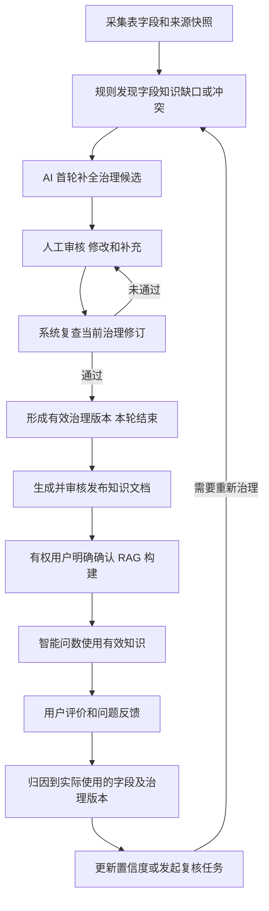

# 字段语义治理与问数反馈闭环改造目标

> 文档类型：用户已确认的产品目标与后续改造依据。目标来源：本次对话中用户明确确认；整理日期：2026-10-24。状态：目标已确认，完整闭环尚未实现；本次只记录目标和差距，不实施代码、数据库或运行环境变更。代码核对基于 `eaac165` 之上的当前工作树；实现状态与验证范围继续维护在[项目现状](../项目现状.md)，执行队列维护在[后续开发](后续开发.md)。

## 1. 用户最终希望实现什么

通过平台治理，让每个字段具有可信的业务标签和解释，说明它是干什么的、什么时候可以用。治理结果用于生成文档，文档进入 RAG，为智能问数提供业务知识。用户对问数结果的评价再反馈到相关字段的置信度，推动字段含义和使用条件持续纠正。

默认治理流程已经确认：

**通过规则发现问题 → AI 做第一轮治理 → 人工审核和补充 → 系统复查 → 本轮治理结束。**

整个过程发生在我们的系统内。用户在平台中处理治理任务、修改治理内容、审核和复查，不被要求到数据库中修改注释或执行 SQL 才能完成字段语义治理。源数据库保持既定只读连接边界；平台保存独立的治理成果及其版本、来源和审核证据。

这里的主要产物是可供智能问数使用的字段业务知识。空值率、主键、重复值等质量检查仍可提供辅助诊断，但不能代替这条语义治理主线，也不能用检查面板和状态按钮代表完整治理能力。

## 2. 完整闭环

“本轮治理结束”表示本批任务已形成可追溯的有效结果。新采集、来源变化、知识冲突或后续负向反馈可以触发新一轮治理；旧版本和旧结论保留，不通过覆盖历史制造“始终正确”的假象。

治理结束、文档发布和 RAG 构建是不同阶段。它们都在平台中完成，但不因前一阶段结束而跳过后一阶段的审核、权限或明确确认。

### 用一个字段串起全过程

以下是说明目标的假设示例，不代表项目现有数据源的真实业务口径。

| 阶段 | 用户在系统内看到或完成的事情 |
| --- | --- |
| 规则发现 | `sales_orders.pay_amount` 缺少有效业务解释和金额单位，生成对应字段的治理任务 |
| AI 首轮 | 推荐“订单支付金额”等候选标签与解释，同时标明金额单位、退款处理口径尚无依据，等待人工确认 |
| 人工审核 | 业务人员依据真实资料确认“订单实付金额，单位分，按元统计需除以 100”，补充适用场景及退款是否另行扣除，审核当前修订 |
| 系统复查 | 检查规则要求的说明是否完整、来源绑定是否有效、审核是否覆盖当前修订；通过后保存本轮完成证据 |
| 文档与 RAG | 用这份已确认的字段知识生成文档，经审核发布及明确确认 RAG 构建后，问数才能消费对应版本 |
| 问数反馈 | 用户反馈金额结果有误时，关联实际使用字段与版本，排查单位换算、退款口径或 SQL 等原因；能够归因到字段知识时，按策略调整置信度并进入复核 |
| 持续纠正 | 如果确认解释遗漏了使用条件，产生新治理修订，重新审核复查，再更新文档与 RAG；保留旧问数使用的历史依据 |

这一流程治理的是平台对字段的理解与使用知识。用户始终在平台内完成操作，AI 对缺少依据的部分保留疑问，复查也不以“填写了一段文字”直接判定业务正确。

## 3. 每个字段最终呈现什么

用户所说的“标签”，应当与业务解释和使用条件一起表达字段的业务身份，而不只是一枚分类徽标。下表是目标信息结构，具体字段设计和页面组织需要在实施时结合现有模型细化。

| 信息 | 要解决的问题 | 示例或边界 |
| --- | --- | --- |
| 业务标签或业务角色 | 这个字段属于什么业务概念 | 客户标识、订单金额、订单状态、业务发生时间等 |
| 业务解释 | 字段具体表示什么 | 面向业务可理解的定义，允许关联已审核术语 |
| 口径与约束 | 字段的含义有哪些限定 | 按需说明单位、枚举含义、统计粒度、计算口径、关联条件等 |
| 使用场景 | 什么情况下适合使用 | 适用指标、查询意图、必要过滤或关联条件 |
| 使用限制 | 什么情况下需要谨慎或不能使用 | 已知歧义、口径冲突、来源过期或待复核状态等 |
| 来源与版本 | 这份解释从哪里来，针对哪个对象有效 | 数据源、快照绑定、稳定字段身份、治理修订及依赖 |
| 审核与复查 | 哪些内容已经被确认 | 候选/草稿与已审核版本分开，保存审核意见和复查依据 |
| 置信度与反馈 | 当前知识可靠程度有哪些使用证据 | 分数、变化原因、实际使用记录及关联反馈 |

不同字段需要的信息不同。金额字段可能需要单位与金额口径，状态字段可能需要枚举含义；不能强迫所有字段填写不适用的同一组内容，也不能让 AI 为凑齐表单编造事实。

原始采集注释、AI 候选、人工修订和当前有效治理结果分别保存、分别展示。平台补充了业务解释，不等于源数据库已经新增注释；后续文档和问数应使用符合审核与来源合同的有效治理版本。

## 4. 规则到底负责什么

### 4.1 主线规则检查字段知识是否完整、可解释、可使用

规则负责找出需要治理的对象与原因，给 AI 和人工提供明确任务。目标中的规则可以围绕下列缺口设计：

| 问题方向 | 规则希望发现的内容 | 后续治理动作 |
| --- | --- | --- |
| 缺少业务标签或用途 | 字段没有可理解的业务身份 | AI 推荐，人工确认或补充 |
| 缺少业务解释 | 没有当前有效、经过审核的字段定义 | 补充解释并审核 |
| 缺少使用所需信息 | 单位、枚举、粒度或使用条件不明确 | 按字段场景补齐必要信息 |
| 知识冲突 | 标签、解释、术语或关系之间存在不一致 | AI 提示依据，人工裁定正确含义 |
| 来源变化 | 原治理结果不再覆盖当前字段或依赖 | 重新绑定、修订和核验 |
| 使用反馈异常 | 反馈或使用证据提示字段理解可能有误 | 归因后发起复核，而非直接改写含义 |

以上是目标问题方向，不表示当前已支持这些可配置规则。结构完整性可以由程序判断；涉及业务语义冲突的判断可能需要 AI 辅助及人工裁定，不能把模型意见直接当成事实。

### 4.2 检查项与规则不是两套治理体系

- **检查项**：程序提供的一种可复用检测方法，例如检查是否存在适用于当前字段的已审核业务解释。
- **规则配置**：将检测方法应用到具体范围并设置要求，例如订单数据源中的字段必须具有有效业务解释。
- **检查结果**：对某个实际对象、规则版本和治理修订产生的结果与依据。

用户主要维护规则和处理任务；检查项在配置规则时按需选择，不成为另一套需要用户单独管理的业务目录。采用已有执行器复用结构是实现选择，不应让用户为理解内部模板概念付出额外成本。

### 4.3 既有质量检查如何保留

当前空值率、重复值、主键、新鲜度等检查可作为辅助质量信号。它们与字段业务知识治理分别表达：AI 补充字段解释，不会让实际空值消失，也不能声称源表已有主键。

应逐项梳理现有规则检测的对象、问题域、处置方式与发布影响。不能为了迁就新主线，直接关闭旧问题、停用旧规则或放宽现有门禁。尤其是“原始注释缺失”与“平台缺少有效业务解释”应保留不同事实，前者不能代替后者，后者治理完成也不能伪造前者已被修复。

## 5. AI、人工和复查各自负责什么

### AI 做第一轮治理

规则发现缺口后，AI 在合规来源范围内生成结构化候选：业务标签、解释、必要口径、使用条件或关联建议，并记录依据、不确定点和对应对象。

AI 输入优先复用平台已有的元数据、已审核术语、已有效治理信息及合法关联事实。它不能把字段名猜测、未审核公式或推测出的枚举含义包装成已确认知识。受限字段和不合规依赖必须在 Java 构造对外 AI 上下文前过滤或拒绝，不能只靠提示词约束。

AI 输出先进入候选或草稿，不能直接成为发布事实。批量处理应保留逐字段成功、失败、缺少依据和待人工确认状态；不能将部分失败隐藏为整批完成。

默认由 AI 先处理。AI 不可用时，应明确记录失败并允许人工接管；人工治理不能依赖供应商账户正常，也不能把人工接管记成 AI 已成功执行。

### 人工审核、修改和补充

人工能够逐字段或批量查看问题、原始资料、AI 建议及依据，选择采纳、修改、补充或退回。重点是确认业务含义与适用条件，不是简单点击“已解决”。

保存、采纳候选、审核通过是不同动作。已经有效的治理版本在新修订完成前仍保留；新草稿不能无声覆盖已审核事实。是否需要独立审核人、哪些内容可批量采纳，由后续权限与审核方案明确，不在本文凭空新增角色或账户。

### 系统复查治理结果

复查针对人工处理后的具体治理修订，验证对应问题是否已按要求处理，包括：

1. 规则要求的信息是否齐全，字段类型和适用条件是否符合要求。
2. 对象是否仍属于同一数据源、快照和真实字段，绑定及依赖是否有效。
3. 要求审核的内容是否有覆盖当前修订的有效审核证据。
4. 系统能够判断的冲突是否解除，尚不能确认的业务争议是否被明确保留。

复查不能通过自动改写人工结论来凑齐通过，也不能保证业务含义绝对正确。需要人工决定的冲突应退回处理或进入明确的待确认状态。

复查未通过时保留原因，回到人工修订；需要重新生成 AI 候选时显式发起。复查通过后，任务关联确切的规则、治理修订、审核与复查记录结束。接口和页面不能仅凭“已填写”或“点了已解决”宣称完成。

当前 `SEMANTIC` 复查证据与 `SOURCE` 质量问题隔离的合同继续保留；统一治理流程需要复用这些约束，不能用一套泛化状态替代它们。

## 6. 治理成果如何进入文档和 RAG

1. 文档生成读取当前符合来源、审核及适用性要求的治理成果，包括业务标签、解释、术语和使用条件。
2. 生成结果可追溯到确切的字段、治理修订和审核依据，不能只保存一段没有来源的自由文本。
3. 文档继续经过审核和发布；完成字段治理不等于文档已经发布。
4. 有权用户在平台内明确确认 RAG 构建，验证新集合后再切换活动指针。
5. 新问数使用符合当前资格的知识；保留旧版本与在途引用，不能提前删除仍被使用的集合。

平台内录入和治理不应被不必要地绑定为“必须先有知识文档或先调用 AI”。进入发布知识与问数事实时，仍须满足已有快照、审核、来源和构建合同。

低置信度、来源变化或新的反馈不自动改写已经发布的文档，也不自动触发一次未经确认的 RAG 替换；需要更新时产生可追溯的新治理修订和后续文档/构建动作。

## 7. 用户评分如何形成持续纠正

### 7.1 先知道用户评价了什么

用户对整次问数的评价，可能来自字段含义、指标口径、过滤条件、SQL 或回答呈现。不能将所有差评平均扣给检索过的所有字段。

反馈应关联实际查询任务、结果所用字段及对应治理版本，并按原因识别哪些反馈可以归因到字段知识。检索候选不等于实际使用，未被采用的字段不能自动承担结果责任。不能可靠归因时，保留待分析/待审核状态。

评价采用点赞点踩、评分或其他形式尚需具体设计；不在本目标文档冻结星级、权重和阈值。

### 7.2 更新置信度并形成事件证据

可归因、符合审核策略的反馈进入字段置信度事件，保存来源任务、字段/治理版本、原因、变化量及审核信息，避免重复提交或重试造成重复计分。

置信度表达的是现有证据支持程度，不是业务正确性的绝对概率。用户评价不能直接覆盖字段定义或自动审核知识；高分也不授予权限。后续可将其用于复核提醒、治理任务触发及已合规候选范围内的使用优先级，具体策略需要实施设计和验证。

现有计分机制是否适合沿用，需要同时审查初始分、反馈归因、正负反馈审核、衰减、权重和恢复方式。不能将旧评分公式未经确认写成最终产品策略。

### 7.3 回到新一轮治理

满足复核条件时创建新的字段治理任务，带上问题及反馈依据，AI 生成新的修订建议，人工再次审核，复查后形成新版本。本轮修订与上一轮的差异应可查看，不能通过分数升降无声地改变字段含义。

跨快照的字段身份、治理修订和置信度证据如何连续关联，是实施设计项。应复用稳定字段定义与快照绑定的思路，不将旧快照行 ID 的分数无条件套到新对象，也不在本文提前决定新表结构或迁移号。

## 8. 用户最终在页面上应看到什么

| 场景 | 首要任务与可见信息 |
| --- | --- |
| 开始治理 | 选择范围和规则，看到待治理字段、问题原因、当前阶段与下一步 |
| AI 首轮完成 | 看到候选标签、解释、使用条件、依据和不确定点，可逐项处理 |
| 人工处理 | 在一个任务上下文中查看原始信息与建议，编辑、采纳、补充或退回 |
| 复查 | 看到明确的通过/未通过项目及对应修订，失败后能直接回到修改位置 |
| 本轮完成 | 看到有效业务知识、版本、审核与复查证据；明确文档/RAG 仍处于哪个阶段 |
| 查看字段 | 同时识别原始信息、当前有效治理结果、待处理修订和置信度变化原因 |
| 问数后反馈 | 能对结果给出评价与原因，必要时定位字段问题；能跟踪是否产生复核任务 |

页面以“下一步处理什么”为中心，解释和技术信息按需展开。不能继续让用户在规则、问题、字段标签、字段解释、文档和反馈之间自行拼接流程。

这不等于要求新建六套页面或复制多套字段编辑器。应复用现有工作面、权限和数据归属，通过任务上下文、嵌入或深链把流程连接起来。具体导航承载需要另行设计；本文不授权把字段解释或脱敏入口擅自迁回原位置，也不覆盖既有已确认的视觉取舍。

## 9. 当前已经有什么，主要差距在哪里

以下是 2026-10-23 的代码核对结果，不是完整闭环已经验收通过的声明。后续实施状态以项目现状为准。

| 环节 | 现有基础 | 需要继续改造的内容 |
| --- | --- | --- |
| 规则发现 | [质量执行器与规则配置](../modules/004-metadata-governance.md#质量规则模板与实例)已有元数据/数据质量检查；存在独立语义复查 | 以字段业务知识缺口为主线梳理规则；检测定义、可配置要求和问题处理方式统一设计 |
| AI 首轮 | [FieldSemanticServiceImpl](../../backend/DataOcean/src/main/java/com/dataocean/module/fieldsemantic/service/impl/FieldSemanticServiceImpl.java)已有单字段 AI 候选、草稿与来源依赖 | 将规则发现的问题、批次和 AI 首轮处理连接起来，保留逐项失败及人工接管 |
| 人工审核 | 字段解释、术语和知识有修订与审核基础 | 组织统一任务上下文，减少跨页拼装；审核必须对应实际候选/修订 |
| 系统复查 | [SemanticCheckServiceImpl](../../backend/DataOcean/src/main/java/com/dataocean/module/fieldsemantic/service/impl/SemanticCheckServiceImpl.java)及语义执行服务已有独立批次和有效性判断 | 扩展目标规则对应的验证，形成审核后复查、退回和结束本轮的编排，不用手改状态替代 |
| 文档/RAG | [知识模块](../modules/006-knowledge.md)已接入 `FIELD_SEMANTIC` 事实，[RAG](../modules/009-schema-rag.md)有明确构建与资格验证 | 新增业务标签与使用条件等内容须完整纳入可追溯事实；补验新治理闭环的端到端输入与失效行为 |
| 字段置信度 | [UserFeedbackServiceImpl](../../backend/DataOcean/src/main/java/com/dataocean/module/fieldtag/service/impl/UserFeedbackServiceImpl.java)和计分服务已有字段级反馈及分数事件 | 设计与治理版本一致的归因、跨快照证据、审核和再治理触发策略 |
| 问数评价接入 | [useQueryExport](../../frontend/src/composables/useQueryExport.ts)调用 S1 问数反馈；[IamS1QueryServiceImpl.feedback](../../backend/DataOcean/src/main/java/com/dataocean/module/query/service/impl/IamS1QueryServiceImpl.java)当前更新查询审计 | 将实际问数评价接入字段反馈闭环；不能因已有字段反馈服务就视为这条链路已接通 |

原始采集注释检查与平台业务解释检查的区别必须保留。当前来源问题门禁、语义问题证据和字段可用状态之间如何承接新的治理流程，需要逐项设计；不能只调整页面名称就宣称产品主线已经完成。

## 10. 建议的实施拆分

下面是实施组织建议，不是已经确定的数据库结构、接口列表或排期。

| 阶段 | 主要工作 | 可验收的结果 |
| --- | --- | --- |
| 1. 明确字段治理产物和规则对象 | 对齐业务标签、解释、条件、来源/修订/审核模型，梳理现有规则和模块复用关系 | 每个字段的原始信息、候选、有效结果和缺口可清楚区分；不重复建第二套权威事实 |
| 2. 串起 AI 与人工治理任务 | 规则发现后发起首轮候选处理，提供人工审核补充及失败接管 | 用户可在平台内完成一批真实字段的 AI 首轮与人工处理，无数据库操作要求 |
| 3. 完成复查与本轮结束 | 绑定规则、对象和修订的复查；通过、退回、部分失败与失效分别处理 | 治理完成有真实证据；旧候选、旧审核或旧复查不能关闭新修订的问题 |
| 4. 验证文档与 RAG 消费 | 纳入有效字段知识，保留文档审核发布及显式构建 | 可证明后续问数实际使用了指定治理版本；失败/失效有明确边界 |
| 5. 打通问数反馈回流 | 关联实际使用字段与版本，按原因归因、审核、计分 | 相同反馈不会重复计分；不能归因的差评不批量误扣字段 |
| 6. 验证持续纠正 | 根据反馈触发复核或再治理，人工确认后产生新版本 | 从一次问数反馈可追溯到置信度事件、治理修订和后续知识更新 |

真实接口、MySQL 迁移、模型服务、RAG 构建、问数验收与人工视觉确认分别保留证据，不互相替代。开始实施前应核对工作树与环境，保留已有修改；有迁移或环境操作需要时遵守当次授权，不从本目标文档推导基础设施、账号或数据操作权限。

## 11. 最终验收应验证哪些事情

- 选定数据源与快照后，规则产生的任务明确指向真实字段及治理缺口。
- AI 首轮生成候选并记录依据，受限内容不会进入 AI 上下文；候选不自动变成已审核事实。
- 人工在系统内完成采纳、修改、补充与审核，不需要到数据库修改源注释。
- 复查针对同一修订及有效来源执行；失败有原因并能退回，成功后保存本轮完成证据。
- 未治理、AI 待确认、人工待审核、复查失败和本轮完成不会混成一种“已处理”。
- 文档可追溯到治理版本，审核发布与明确确认 RAG 构建分别发生；新问数可证明实际用了该版本。
- 用户反馈可关联实际使用字段及版本，不能将检索候选当作结果贡献字段；重复反馈和不明原因不造成错误计分。
- 置信度变化有事件和原因，需要纠正时产生新的复核/治理任务，而不直接覆盖已审核定义。
- 单轮结束后仍能因新来源或新证据发起新轮次，旧版本、审核与历史问数依据可追溯。
- 对治理完成、置信度较高或 RAG 已收录的字段，权限、来源有效性、当前审核与 SQL 安全检查仍然生效。

## 12. 本文与其他材料的关系

本目标来自本次对话中用户明确确认的产品主线。后续方案、实现与验收均应对照它，不能因旧规格或现有代码只支持质量检查，就反向缩减为“发现问题后让用户去数据库整改”。

历史方案中的技术边界和已验证实现可复用；与本目标不一致的业务组织方式应记录差距后调整，不能直接恢复旧方案中的操作或授权。现行实现见[治理模块](../modules/004-metadata-governance.md)、[知识模块](../modules/006-knowledge.md)、[问数与记忆](../modules/008-query-memory.md)和[RAG](../modules/009-schema-rag.md)。

OpenMetadata 可用于参考元数据丰富化、协作治理以及检查定义/实例分层，但本项目的最终范围以用户确认的闭环为准，不将特定产品或版本的全部能力视为本项目现状，也不将本目标声明为已实施完成。
