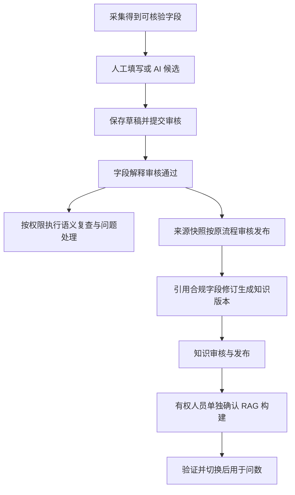

# 质量规则页面与平台内字段语义治理方案

> 状态：最终设计方案；定稿日期：2026-10-21。2026-10-22 按本文开展代码实施，当前工作区实现与验收状态见[项目现状](../项目现状.md#2026-10-22-质量规则与平台内字段语义实施)。
> 实现核对基线：`81bf017`；实现保存在未提交工作区，未更改原有提交。
> 依据：用户提供的质量规则列表、规则详情两张截图，以及现存治理、知识、IAM 和 RAG 实现。本文确定目标行为与实施合同；代码存在、H2/单元测试、MySQL 迁移、真实 API、RAG build 和人工页面验收分别记录，互不替代。

## 1. 产品目标

DataOcean 应帮助用户把接入的数据解释清楚，形成可维护、可审核、可复用的业务知识。字段含义不清时，用户能在平台内获得解释建议、补充业务依据、确认定义，并看到这些治理成果何时用于问数。

治理成果保存在 DataOcean。业务数据源继续使用只读连接，平台保存原始采集事实、平台业务解释及各自来源；重新采集后保留有效的人工治理成果，并对结构变化提示复核。

本方案采用“独立字段语义修订作为权威记录，知识文档引用精确版本”的实现方式。人工填写和 AI 辅助都从字段进入，允许在快照发布前整理解释；进入问数仍必须满足现有知识审核、发布、独立构建及查询安全合同。

当前能力与证据以[治理模块](../modules/004-metadata-governance.md)、[知识模块](../modules/006-knowledge.md)和[项目现状](../项目现状.md)为准；本方案维护目标、实现合同和验收要求，执行状态进入[后续开发](后续开发.md#11-质量规则页面与平台内字段解释)。

## 2. 当前功能实际承担什么

| 入口 | 当前职责 | 用户使用它要完成的任务 |
| --- | --- | --- |
| 质量规则 | 根据已注册模板配置范围、条件、严重程度、扣分和启停 | 定义检查标准 |
| 治理总览 | 针对数据源和快照执行检查，查看批次覆盖和问题 | 了解哪些对象存在什么问题 |
| 问题中心 | 查看、分派、确认、处理和复查问题 | 跟踪问题处理过程 |
| 资产状态 | 管理发现、正常、推荐、废弃、禁止等状态 | 决定对象的治理准入状态 |
| 字段治理 | 当前主要是标签、可信度、反馈和脱敏候选 | 管理字段标识和使用保护 |
| 语义中心 | 术语、字段映射、AI 释义候选、知识审核发布及后续索引构建 | 沉淀和发布业务口径 |

质量规则页是标准配置入口。字段的业务解释需要通过字段治理、问题处理与语义知识流程协作完成。

本轮代码核对确认以下情况：

1. `CompletenessChecker` 用采集快照的 `tableComment/columnComment` 判断注释缺失，提示“建议补充注释”；尚未在这项检查中消费经过审核的平台字段解释。
2. `GovernanceFieldsView` 当前展示标签、可信度、反馈审核和脱敏候选，没有承接字段业务解释的完整操作流程。
3. 现有知识流程已经支持 AI 释义候选、人工采纳、审核和发布；候选以文档为操作中心，用户从字段问题进入时仍缺少集中入口。
4. 规则同时包含元数据结构检查和真实数据只读检查，不能全部按同一种处理方式呈现。数据级检查当前有抽样覆盖限制。
5. `TIME_TABLE_NO_UPDATE` 当前根据估算行数为零提示“可能长期无数据写入”；这个证据不足以证明长期未更新。首阶段在模板说明、详情和执行摘要明确“估算为空表，未证明长期未更新”，不自动改写已有实例名称、模板编码或历史结果。基于时间字段的 `DATA_STALE_TABLE` 单独说明其实际时间依据，本方案不扩展或替换其扫描算法。

因此，现有能力可以复用，但“字段含义不清”的发现、解释、确认、复查和问数使用尚未在字段这一层形成完整流程。

## 3. 两张截图的页面问题与美化方向

### 3.1 列表：减少重复，让规则更容易理解

截图 1 中，规则名称与检查类型大量重复；操作列同时展开详情、编辑、复制、删除，占用较多空间。表格右侧仍有启用状态等信息，当前宽度分配让核心状态不容易被看到。标题与表格之间的留白较大，筛选项的用途主要依赖占位文案。

沿用现有海蓝画布、侧栏、公共 ScopeBar 和白色工作面板，集中调整内容区域：

- 标题与主要操作在同一行，收紧标题上下留白。保留一个页面主标题和标题旁说明入口。
- 常用筛选保留搜索、检查类别和状态；范围、维度和已删除筛选放入可展开的筛选区。展开后仍有清楚的可见标签，收起时保留已生效条件与清除入口。
- 范围切换改为“当前数据源适用规则 / 全局规则”。前者包含实际适用的全局继承规则，行内明确标为“全局默认”，避免选择“数据源规则”却看到“全局”而产生误解。
- 全局规则维护视图明确说明不受上方快照限制；继续使用现有公共范围栏，不新增第二套数据源或快照选择器。
- 规则名点击查看详情；每行保留“编辑”和“更多”，将复制、删除等放入菜单，保留权限控制、删除确认及恢复语义。
- “资产状态维护”放到次要关联入口，主操作仍为新增规则。

主表结构：

| 列 | 呈现方式 |
| --- | --- |
| 规则 | 主行名称；次行显示不重复的条件摘要，维度用文字或轻量标签表示 |
| 检查对象 | 明确“元数据 / 业务数据 / 平台语义”；语义模板在执行器就绪后才公开 |
| 适用范围 | 全局默认、当前源、表或字段；长路径可查看完整内容 |
| 级别与影响 | 来源质量显示严重程度及扣分；平台语义显示处理优先级和“仅提示、不计分”；不能只靠颜色识别 |
| 状态 | 启用、停用、部分目标被覆盖、无执行模板等真实状态 |
| 操作 | 编辑、更多；查看详情由规则名承担 |

配置版本移入详情。首轮不新增装饰性统计卡片；若后续展示最近执行和命中数，必须由后端按真实范围聚合，不能用当前页条数或缺少记录推导执行结论。

桌面优先保证规则、范围、启停和操作可见。必要横向滚动只发生在表格区域；窄屏筛选自然换行，不挤压成无法辨认的小控件。固定操作列的阴影只在确有横向溢出时出现。

### 3.2 详情：先解释规则，再展示技术与历史

截图 2 的信息顺序接近配置对象的字段顺序，参数直接显示 JSON，执行与迁移说明同时占据主区域。用户仍需要自行理解检查条件、覆盖范围和下一步操作。

使用桌面右侧详情抽屉，窄屏全屏展示；沿用现有组件与样式令牌。抽屉顶部显示规则名称、启用状态及可执行性，正文分为三个页签：

1. **检查说明**：检查什么对象、何时触发、使用什么证据、会带来什么影响，以及去哪里处理。
2. **执行记录**：批次、实际配置版本、目标数量、检查覆盖、发现问题与失败原因；可跳到对应问题。
3. **配置记录**：版本、操作人、时间、变更内容；迁移基线与真实后续变更分开标识。

参数默认转换为业务文案。例如 `staleDays: 30` 显示“超过 30 天未更新时提示”。具体读取哪个时间字段应以可核对的执行记录为准，不能在未执行时假定使用了某个字段。原始配置放入“技术详情”。

没有带版本的历史记录时显示“暂无可追溯执行记录”，不推断“从未执行”。旧结果缺少版本依据的限制继续保留在适当说明中，不补造历史。

### 3.3 新增和编辑：配置时看得懂影响

保留模板驱动表单，将流程清晰分为“选择检查 → 指定对象与条件 → 设置影响”。选择模板后实时显示自然语言预览；范围覆盖和启用影响在保存前可见。仅展示已有执行器支持的模板，不添加不可执行的装饰性选项。

可访问性方面需在实施后检查筛选标签、菜单及抽屉键盘操作、焦点返回、状态说明、对比度和窄屏滚动；本轮截图只能支持风险判断，不能作为这些交互已经通过的证据。

## 4. 字段解释的权威记录与操作流程

### 4.1 采用独立字段语义修订

Java/MySQL 保存字段语义主记录、不可变内容修订、来源绑定、AI 候选和审核记录。**已经审核且来源有效的字段语义修订是平台字段解释的权威来源。** AI 候选、实体展示描述和知识正文均不能单独替代它。

| 逻辑记录 | 必须保存的内容与用途 |
| --- | --- |
| 语义主记录 | 独立 `definitionId`、数据源、字段定位、当前审核版本、工作草稿及并发版本号 |
| 内容修订 | 业务名称、含义、单位/币种、枚举含义、口径与适用限制、依据、作者、内容 hash；提交后固定，修改创建新修订 |
| 来源绑定 | 精确数据源、数据库、快照、表/字段元数据 ID、结构指纹和完整依赖，绑定独立版本及有效状态 |
| AI 候选 | 绑定字段、来源快照、基础修订、冻结输入、候选文本和待确认项；采纳后只写草稿 |
| 审核记录 | 审核结论、审核人/时间、意见、精确内容修订和来源绑定、内容及依赖摘要 |
| 语义检查记录 | 检查批次、规则版本、实际语义/审核/绑定版本、目标覆盖、判定与原因 |

目录、字段治理和问题中心读取同一权威记录；知识文档保存对精确修订及审核证据的引用和内容快照。文档可以组织展示内容，不能直接改写已经审核的字段定义。`metadata_entity.description` 只作为展示信息，不能作为无审核的语义事实源。

首版支持人工直接创建解释，不依赖已有知识文档或 AI 调用成功。现有 `KnowledgeSemanticCandidate` 绑定文档与文档版本，继续服务原流程；新字段候选不能用空 `docId` 强塞进原模型。复用现有元数据过滤、提示词、模型客户端、版本校验和审核实现模式，字段候选的身份和持久化独立。

业务术语仍是共享业务概念。字段修订可引用精确的已审核术语及其有效映射，不要求每个字段创建一个术语，也不能在字段编辑时悄悄修改术语定义或映射。术语依赖必须完整且适用当前数据源，跨源或不完整依赖不能裁剪成有效本源事实。

### 4.2 明确来源身份和重新采集规则

`definitionId` 不使用随快照变化的字段元数据 ID。每次使用必须通过来源绑定定位到同一数据源、数据库、表、字段和指定快照，不能仅凭字段同名匹配。

首版对新采集快照保留原人工内容并生成待确认绑定，不自动把旧审核证据扩展到新来源。结构、单位依据、关联术语或完整依赖变化时明确标为需复核；字段删除、重命名或同名重建不得自动重绑。允许有权限人员批量确认没有变化的绑定，但每项仍要核验、记录依据，并报告部分失败。

来源绑定确认复用旧内容时，创建针对新绑定的审核证据，不改写旧审核记录。原快照及旧定义保留供追溯；历史对象不能在读取失败时回退到最新快照。BLOCKED/DEPRECATED 对象不能借语义绑定恢复 AI 生成、知识检索或问数资格。

### 4.3 从字段进入，人工和 AI 两种输入并行

字段治理新增“业务解释”作为主要工作面，原标签、可信度、反馈和脱敏页签继续保留。对象目录和问题详情提供定位入口，沿用唯一公共 ScopeBar，核对数据源、快照、表和字段，不新增范围选择器。

界面分别展示原始采集注释、当前已审核解释、正在编辑的草稿和 AI 候选。必填业务名称、含义、目标来源与依据；单位、枚举和口径按实际适用性填写。无法确认的部分保留待确认项，不能当作已审核事实，也不据此生成金额换算、状态过滤或计算公式。

示例，仅用于说明目标交互：`orders.pay_amt` 原始注释为空。AI 可建议“可能是订单支付金额”，并列出单位、币种和退款口径待确认；业务人员核对后填入“订单实际支付金额，单位为人民币元，退款另行记账”。人工内容提交审核后成为适用来源上的平台解释；原始注释仍显示为空。

AI 首版只接收有权限的元数据、同表上下文、合规关系和适用的已审核术语，不读取业务行，不自动发送已有采样值。返回“建议解释、参考依据、待确认问题”，不能自报审核通过、猜定数字枚举含义或编造公式。

所有写操作携带预期版本；AI 生成前、结果写回前都核验权限、字段归属、基础修订和来源。过期返回 409；关闭、切换字段或范围后旧响应不能覆盖新页面。AI 不可用时保留草稿并允许人工填写；重试不能覆盖已保存内容。

### 4.4 发布前即可整理，问数使用仍需发布与构建

字段解释可基于已采集且来源可核验的未发布快照建立草稿、提交和审核，不要求先创建知识文档。字段审核只说明这份解释适用于所审核的来源，不把该快照自动标为已发布，也不绕过原有来源质量门槛。

修订工作流采用 `DRAFT → PENDING_REVIEW → APPROVED`。驳回记录固定结论，后续修改以新草稿修订承接，不改写原提交及审核输入；页面可显示“已退回，待修改”。采纳 AI 候选只产生草稿，不等同于审核通过。已经提交或批准的内容和依据不可原地修改，当前工作状态和有效版本由主记录及审核记录表达。

发布前的字段解释不会进入问数。快照发布后，知识生成仍校验同一来源绑定、审核证据和完整依赖；文档审核、发布及 RAG 构建继续使用原合同，不自动串联。

页面分别显示语义工作状态、来源绑定状态、问数收录状态。审核通过但尚未构建时显示“解释已审核／问数待收录”，不能仅显示一个含义不明的“已生效”。

## 5. 权限、审核与审计

复用现有 S1 固定功能目录，不新增随意拼造的权限码，也不自动给现有账号提权。每项权限都核对该功能所在角色绑定的当前数据源范围；不能从一个绑定取功能、另一个绑定取负责源。需要多项权限时逐项满足同源条件。

| 操作 | 必须满足的现有权限 |
| --- | --- |
| 目录展示有效已审核解释 | `metadata:view` 及当前对象、来源范围 |
| 字段治理工作面查看解释和状态 | `governance:field:view`；查看草稿、候选及审核细节另需 `knowledge:view` |
| 创建/编辑草稿、AI 生成/采纳、提交、撤回待审核草稿 | `governance:field:manage` 与 `knowledge:manage` |
| 审核通过/驳回字段解释 | `governance:field:view` 与 `knowledge:approve` |
| 撤销已审核解释 | `governance:field:manage` 与 `knowledge:approve`，记录原因并使相关使用立即失效 |
| 引用现有已审核术语 | 另核验 `glossary:view`；改变术语或映射须走原 `glossary:manage/approve` 流程 |
| 生成/编辑知识草稿 | 原 `knowledge:manage` 及文档、来源与字段事实校验 |
| 知识审核、发布、显式 RAG 构建 | 分别沿用 `knowledge:approve`、`knowledge:publish`、`knowledge:publish` |
| 执行语义复查 | `governance:check` 及当前快照范围 |
| 分派、确认、解决或驳回问题 | `governance:issue:manage` 及当前问题范围 |
| 维护规则实例 | 数据源级沿用 `governance:rule:manage`，全局级沿用受保护系统管理员合同 |

前端显隐和禁用用于说明可用动作，Java 服务端执行最终授权。审核人不因为可以查看就获得编辑或发布权；创建者也不因提交而自动成为审核人。本方案不新增强制双人审批，同一账号只有实际具备相应权限时才能完成各环节。

保存、提交、审核、驳回、撤销、绑定确认及问题处理均记录真实操作人、时间、理由和预期版本。提交后审核输入固定；审核时再次核验版本、来源、术语和当前权限，发生变化返回冲突，不覆盖他人修改。主事务提交后再执行来源失效通知等辅助工作，不能用辅助失败误报主操作失败。

## 6. 来源质量与平台语义分别执行

### 6.1 两类检查域及其影响

| 检查域 | 判定对象 | 计分、状态与发布影响 |
| --- | --- | --- |
| `SOURCE` 来源质量 | 原有元数据及只读业务数据检查 | 保留原规则版本、评分、严重程度、快照与治理状态联动、发布门槛和抽样覆盖限制 |
| `SEMANTIC` 平台语义 | 已审核字段修订、来源绑定和依赖是否有效 | 首版仅提示、不计分、不改变快照/表字段治理状态，不阻断快照发布，不联动现有字段可信度加减分 |

检查域由模板注册表和服务端决定，不能由客户端任意传入。语义模板仍遵循全局、数据源、表、字段的范围与覆盖规则；只有对应执行器、权限和结果记录全部就绪后才开放创建或执行。

语义复查使用独立的批次/结果记录，不直接进入 `QualityCheckServiceImpl` 的评分、`APPROVED/ISSUE_FOUND` 更新或 HIGH 问题治理联动。仅把扣分设为零不是实现隔离的办法。

问题中心复用统一问题处理体验，新增服务端确定的 `issueDomain` 区分来源质量与字段语义。既有记录明确归为 `SOURCE`，不能把未知值默认当作非阻断问题。快照发布门槛、质量计分、旧问题清理和可信度联动显式限定 `SOURCE`；原有 SOURCE 的 HIGH 问题门禁保持不变。语义问题即使处理优先级高，也不能被原“所有 HIGH 问题”查询误判为发布阻断。

语义复查不得删除或自动关闭同维度的来源问题，来源全量检查也不得清理语义问题。新语义检查不修改旧批次和历史评分。问题中心提供“全部／来源质量／字段解释”筛选，总数和分域数量由后端按当前权限范围统计，不按当前页记录推算。

### 6.2 首版规则与原始注释的处理

首版仅交付两类确定性语义检查，Java 根据持久化事实判断，不调用 LLM、不扫描业务行：

| 情况 | 判定与结果 |
| --- | --- |
| 从未形成经过审核的业务名称和含义 | 缺少可用解释，进入语义待办 |
| 有审核记录，但当前绑定、依赖或审核依据已失效/被撤销 | 解释需复核，显示具体失效原因 |
| 当前审核及绑定有效，同时存在新草稿 | 当前解释仍有效，另显示草稿，不制造缺失问题 |
| 字段不在当前合规范围或被禁止/废弃 | 记录不适用及原因，不纳入可用解释统计，不执行 AI 或查询 |

同一字段同一批次的缺失与失效判定互斥，不能重复建问题。语义覆盖统计分别显示适用、已审核有效、待补充、需复核和不适用；失败、加载中和无权限不能显示为零或全部通过。

`COMP_TABLE_COMMENT_MISSING/COMP_COLUMN_COMMENT_MISSING` 继续如实检查原始采集注释。平台解释不写回 `tableComment/columnComment`，也不把这些来源问题伪造为已解决。来源质量分与平台语义覆盖分开展示，平台字段解释可以完成而来源质量仍有提示。

本功能不自动停用或降低任何既有 SOURCE 规则，包括用户配置为 HIGH 的注释缺失规则。若原配置仍阻断发布，由有权规则维护者在平台内显式调整该来源规则的后续配置并重新检查，保留配置修订；不能借字段审核偷偷解除既有门禁，也不要求修改源库注释作为填写平台解释的前提。

自动判定业务口径矛盾、单位推断、枚举推断和自由公式执行不属于首版；人工可提交复核说明，但不能把模型判断直接算成确定质量结论。物理外键缺失与受控逻辑关系仍分开表达。

### 6.3 语义问题复查与解决证据

字段解释审核后提示可执行语义复查，不自动把任意问题改成已解决。执行者需要检查权限；处理者需要问题管理权限，问题状态仍按现有合法流转和预期状态条件更新。

复查记录必须冻结问题 ID、字段、来源快照/绑定、规则版本、语义修订、审核记录及 hash。只有最新有效复查已通过且这些依据仍未变化时，才能解决相应的语义问题；发生并发变更返回冲突。批量返回逐项更新/跳过原因，不报全成功。

解决“缺少平台解释”不会顺带解决原始注释缺失、空值、重复或引用异常。后几类仍按其真实检查依据处理，不能以备注或关闭问题代替数据修复。

## 7. 版本失效、知识使用与历史

### 7.1 明确生效时点

| 动作或事件 | 当前解释与新查询的行为 |
| --- | --- |
| 创建或编辑新草稿、生成候选 | 当前已审核版本继续有效；草稿只对有权维护者展示 |
| 驳回新修订 | 退回草稿，当前已审核版本不变 |
| 审核通过新修订 | 原子切换当前审核版本，旧修订只供历史追溯；引用旧修订的知识不再用于新查询，页面显示问数待收录 |
| 撤销当前已审核解释 | 当前解释失效；不自动回退到更早版本，相关事实立即从新查询候选中排除 |
| 已核实字段/完整依赖变化或消失 | 相关来源绑定标为需复核/不可用；针对该绑定的事实不能继续使用 |
| 新快照采集 | 人工内容保留，创建待确认绑定；原来源的有效性按原绑定和实际资源状态核对 |
| 恢复历史文字 | 创建新修订、重新审核并走知识发布及独立构建，不直接复活旧审核证据 |

状态变化和使用资格在主事务内完成；Java 的使用校验读取当前资格，不能只依赖异步通知或等向量删除完成后才停止使用。构建失败不回退到已失效的旧事实，也不撤销已经成功的人工保存。

### 7.2 知识引用精确版本，失效不能等下一次构建

新增受控事实类型 `FIELD_SEMANTIC`，与既有 `GLOSSARY_TERM/SEMANTIC_NOTE` 区分。文档生成引用精确 `definitionId/revisionId/reviewId/bindingId`、内容及完整依赖 hash；不能把字段解释伪装成已确认的文档候选，也不允许模型填写可信审核标记。

Java 在文档审核/发布、构建冻结与 S1 membership 校验时核对当前审核、绑定及依赖，Python 保留事实类型、来源和版本信息并执行请求级候选过滤。新类型必须同时接入事实校验、切分/检索、重排、相邻扩展和查询授权链；任一环节未支持时拒绝纳入，不能按普通文本或旧类型兜底。

解释更新或撤销后，无须等待新 build 或删除旧向量，当前 Java 可授权 membership 就要排除旧事实。新 build 仍经明确确认、验证后切换；旧活动集合和在途引用按原生命周期保留，失效过滤不等于提前删集合。

查询绑定快照、build 和事实版本。引用的语义修订、审核、绑定及摘要随授权证据由 Java 固定，不能仅由模型或客户端自报。候选授权、执行前与最终结果保护都要复核相关字段语义使用资格；在途任务遇到引用事实失效时停止返回依赖该事实的结果，提示重新发起，不切到另一个 build 继续，也不放宽 PROTECTED attemptId 和精确 SQL hash 的完成合同。

尚未收录新版本、相关知识失效或模型不可用时，明确显示待更新/不可用，不能靠旧解释或无来源猜测补出成功结果。其他仍合法的独立事实不因单个字段失效而被无差别删除。

历史修订、审核、文档和任务证据保留，不重写历史结论。历史结果读取继续遵循现有当前 IAM、治理限制与脱敏规则；历史展示不等于允许重新执行失效事实。

## 8. 实施顺序与验收要求

### 8.1 分阶段交付

| 阶段 | 交付 | 完成要求 |
| --- | --- | --- |
| 1. 规则页面整理 | 第 3 节列表、抽屉、自然语言参数、范围与影响表达 | 不改原执行和权限语义；不展示未支持的语义模板 |
| 2. 字段语义基础 | 权威修订、候选/审核/绑定、权限矩阵、人工输入、发布前治理、并发控制和失效资格 | 新草稿不影响旧有效版本；审核/撤销和源变化有确定状态，不依赖 AI 或知识文档才能保存 |
| 3. 语义复查与问题处理 | 独立语义批次、问题域、两类确定性规则、复查证据、目录/问题页统一读取 | SOURCE 评分、快照门禁和可信度联动不被 SEMANTIC 污染；来源与语义问题不会互相清理 |
| 4. 知识与问数接通 | `FIELD_SEMANTIC` 全链校验、知识版本引用、显式构建、实时失效与在途保护 | 新定义经完整发布构建后使用；旧事实失效立即过滤且不提前删除在途集合 |

第 2、3 阶段的“已审核”只表示平台解释可读；必须到第 4 阶段验收后才能宣称问数接通。每阶段更新现行模块与状态文档，不把文档完成当作代码完成。

### 8.2 必须覆盖的验收场景

1. 原始注释为空、快照未发布、没有知识文档且模型不可用时，仍能人工保存、提交并审核字段解释；不能因此自动发布快照。
2. AI 只能写候选/草稿；生成期间字段、版本、权限或来源变化时拒绝过期写回，人工内容不丢失。
3. 仅有查看、维护、审核或发布其中一种权限的账号只能完成对应动作；不同绑定的功能和负责源不能被错误合并，越权接口必须拒绝。
4. 两人编辑/审核、重复采纳、关闭后返回、跨源/快照/字段快速切换均不能交错覆盖；事务失败不留下半份审核记录或错误的当前版本指针。
5. 原文档的已确认 AI 候选与知识发布流程继续工作，不能把旧记录无证据迁成已审核字段定义。
6. 语义检查可发现并复查问题，但不改变 SOURCE 分数、快照状态、治理状态、可信度及原 HIGH 门禁；来源检查和语义检查都不能误清另一域的问题。
7. 解释审核后只允许用相应有效复查证据处理语义问题；修订、绑定或规则变化后旧证据不能再解决问题；原始注释问题不被顺带关闭。
8. 新草稿不影响当前解释；审核新版本、撤销、依赖失效和同名重建分别触发正确的资格变化；重新采集保留人工内容但不盲目继承审核。
9. 旧 build 尚未重建时，新查询也不能取到失效字段事实；在途查询不切 build、不返回依赖失效事实的结果；旧集合按引用生命周期保留。
10. 完整走通“人工/AI 草稿 → 字段审核 → 语义复查 → 知识审核发布 → 单独确认构建 → 后续问数使用”，并显示各自版本及状态。
11. 列表、筛选、菜单、抽屉在桌面/窄屏可读，键盘和焦点返回可用；加载、无权、失败、无范围、零结果和筛选无匹配分别呈现。

代码使用定向单元/集成测试验证；涉及持久化、事务与并发使用真实 Spring 代理或独立 H2。阶段代码和已执行的定向检查见下方 §8.4 与[项目现状](../项目现状.md#2026-10-22-质量规则与平台内字段语义实施)。MySQL 迁移、真实 API、RAG build 和手动页面验收仍分别保留证据，不能互相替代。

### 8.3 实施边界

前端只调用 Java；Java 管理持久化、IAM、版本和审核，Python 负责受控 AI 与 RAG 执行。业务库继续只读；不新增数据库级外键，不建立第二套 Python 语义事实库，不自动建索引或改变账号权限。

实现所需迁移在开工时重新核对最高占用版本并按授权流程处理，V53 永久不用；本文不预占迁移号、不执行迁移或新建基础设施。物理字段与索引、DTO 和服务拆分可以按既有规范细化，但不得改变本文已确定的权威来源、权限、状态和失效合同。

### 8.4 2026-10-22 工作区实施状态

| 阶段 | 工作区代码状态 | 验收边界 |
| --- | --- | --- |
| 1. 规则页面整理 | 规则摘要、范围/影响表达、更多操作、详情抽屉三页签、自然语言参数说明已实现；补充了展示工具函数回归 | 定向前端测试和生产构建通过；桌面/窄屏视觉、键盘及焦点返回仍待用户手动验收 |
| 2. 字段语义基础 | 新增独立定义、来源绑定、不可变修订、AI 候选、审核证据和同源 S1 权限校验；采集新快照后创建待确认绑定；提供逐项及批量确认工作流 | 独立 H2/Spring 代理测试覆盖并发版本、AI 过期、审核/撤销、复采绑定、批量预授权与部分失败；真实 S1 角色矩阵 API 未跑 |
| 3. 语义复查与问题处理 | 新增独立语义批次/结果和 `issueDomain`；SOURCE 清理、评分、置信度及 HIGH 门禁显式限定 SOURCE；语义问题解决要求最新有效复查 | 独立 H2 测试覆盖来源/语义隔离、复查、撤销后旧证据失效；未运行真实 API |
| 4. 知识与问数接通 | `FIELD_SEMANTIC` 已接入快照文档生成/校验、Python chunker、build membership、Java 当前资格过滤、任务固定引用与在途重验；显示活动 build 收录状态 | 定向 Python、Java 过滤和在途保护测试已覆盖；未执行真实知识审核发布、独立确认 RAG build 或后续问数，因此本阶段端到端验收未完成 |

V69 迁移脚本已经创建，最高已占用版本复核为 V68；本轮没有对现有数据库执行迁移、启动 Java 服务、写入应用库或生成真实 RAG build。页面不使用浏览器自动化/截图；视觉验收保留给用户。逐项和批量来源确认均已实现；批量流程先核验整批来源与权限，再逐项提交并返回部分失败原因。相关测试与明确限制见[验收交接记录](../项目现状.md#2026-10-22-质量规则与平台内字段语义实施)。

## 9. 现行实现核对入口

- [现行治理模块说明](../modules/004-metadata-governance.md)、[现行语义知识说明](../modules/006-knowledge.md)、[前端规范](前端开发规范.md)。
- [现行 IAM 合同](../modules/007-iam-s1.md)、[RAG 构建与检索合同](../modules/009-schema-rag.md)。
- [质量规则页面](../../frontend/src/views/admin/governance/QualityRulesView.vue)、[字段治理页面](../../frontend/src/views/admin/governance/GovernanceFieldsView.vue)。
- [完整性检查](../../backend/DataOcean/src/main/java/com/dataocean/module/governance/checker/CompletenessChecker.java)、[元数据时效检查](../../backend/DataOcean/src/main/java/com/dataocean/module/governance/checker/TimelinessChecker.java)、[只读数据检查](../../backend/DataOcean/src/main/java/com/dataocean/module/governance/checker/DataQualityChecker.java)。
- [已有 AI 释义候选与采纳流程](../../backend/DataOcean/src/main/java/com/dataocean/module/knowledge/service/impl/KnowledgeSemanticServiceImpl.java)。
